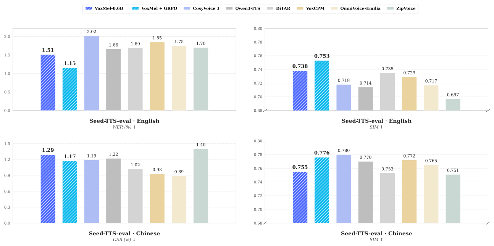
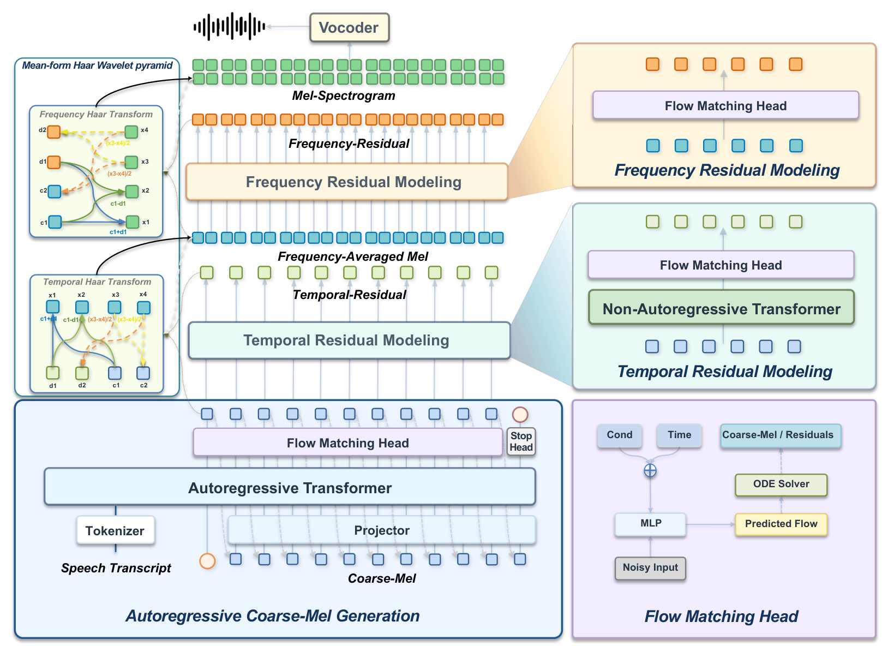

<h2 align="center">VoxMel: Wavelet-Factorized Autoregressive Mel-Spectrogram Modeling for Zero-Shot Speech Synthesis</h2>

<p align="center">
  <b>English</b> | <a href="./README_zh.md">中文</a> | <a href="./README_jap.md">日語</a> | <a href="./README_kor.md">한국어</a>
</p>

<p align="center">
  <picture>
    <source media="(prefers-color-scheme: dark)" srcset="assets/voxmel-logo-dark.png">
    <source media="(prefers-color-scheme: light)" srcset="assets/voxmel-logo.png">
    
  </picture>
</p>

<p align="center">
  Technical Report (coming soon) |
  <a href="https://voxdance.github.io/voxmel-demo">Project Page</a> |
  <a href="https://github.com/VoxDance-Lab/voxmel">GitHub</a> |
  <a href="https://huggingface.co/VoxDance-Lab/VoxMel-0.6B">Hugging Face</a>
</p>

**VoxMel** is a tokenizer-free continuous autoregressive text-to-speech (TTS) framework that directly models mel-spectrograms through a fixed, exactly invertible two-axis Haar transform. A language-model backbone with a flow-matching head generates **Coarse-Mel** autoregressively; two non-autoregressive residual tiers recover temporal and frequency details without feeding them back into the autoregressive history. A separate Vocos vocoder converts the reconstructed mel-spectrogram into speech.

Trained on **100K hours of Emilia**, VoxMel is evaluated on English and Chinese zero-shot voice cloning. The **0.6B** supervised model achieves **1.51% WER / 0.738 SIM** on Seed-TTS-eval test-en; frozen-head GRPO improves this to **1.15% WER / 0.753 SIM**. See [Evaluation](#-evaluation) for comparisons and the evaluation protocol.

### ✨ Highlights

- **Direct mel modeling** — No learned acoustic tokenizer or compressed acoustic latent space; the text frontend uses the Qwen2.5 tokenizer.
- **Exactly invertible decomposition** — Frequency and temporal Haar splits preserve all mel coefficients. Exact invertibility applies to the transform, rather than guaranteeing lossless generated audio or vocoder reconstruction.
- **Coarse-only autoregression** — Generate Coarse-Mel first, then the temporal residual and frequency residual in dependency order. Residual details stay outside the autoregressive history.
- **English and Chinese zero-shot cloning** — Synthesize speech from reference audio and its transcript, with 24 kHz output in the paper's configuration.

- **Post-training** — Frozen-head GRPO improves all four Seed-TTS metrics.

---

## Contents

- [Performance](#performance)
- [Model Architecture](#model-architecture)
- [Quick Start](#-quick-start)
  - [Installation](#installation)
  - [Prepare Model Files](#prepare-model-files)
  - [Python API](#python-api)
  - [CLI Usage](#cli-usage)
  - [Web Demo](#web-demo)
- [Models](#-models)
- [Method](#-method)
- [Evaluation](#-evaluation)
  - [Seed-TTS-eval Results](#seed-tts-eval-results)
  - [Seed-TTS Batch Evaluation](#seed-tts-batch-evaluation)
- [License](#-license)

---

<a id="performance"></a>

## Performance



Seed-TTS-eval comparison with representative systems. Blue: supervised VoxMel-0.6B; cyan: VoxMel-0.6B + GRPO. See [Evaluation](#-evaluation) for the full table.

<a id="model-architecture"></a>

## Model Architecture




---

## 🚀 Quick Start

### Installation

Use Python 3.10–3.12. Install matching PyTorch and torchaudio builds for your
hardware (the original environment uses torch/torchaudio 2.4.1 with CUDA 12.1),
then install from the repository root:

```bash
pip install -e .
```

`requirements.txt` is shared by the package installer. Vocos is included.
For CPU or Apple Silicon, use the appropriate PyTorch build. `device="auto"`
selects CUDA, then MPS, then CPU; an unavailable explicit device raises an error.
MPS operator support and performance still require validation with your checkpoint.

### Prepare Model Files

This checkout includes model code and a Qwen tokenizer, but **no trained VoxMel
weights, experiment config, or Vocos weights**. Supply a compatible experiment:

```text
/path/to/experiment/
├── config.yaml
└── model_L_final.pt
/path/to/vocos-mel-24khz/
├── config.yaml
└── pytorch_model.bin
```


### Python API

```python
from voxcore import VoxMel
import soundfile as sf

model = VoxMel.from_pretrained(
    "/path/to/experiment",
    tokenizer_path="examples/voxmel/qwen_tokenizer",
    vocos_path="/path/to/vocos-mel-24khz",
    device="auto",
)

# Audio continuation cloning requires the exact reference transcript.
wav = model.generate(
    "这是声音克隆的演示。",
    prompt_wav_path="reference.wav",
    prompt_text="参考音频中实际说出的内容。",
    cfg_text_strength=3.5,
    cfg_spk_strength=3.0,
    seed=42,
)
sf.write("clone.wav", wav, model.sample_rate)
```

The API returns a mono float32 NumPy waveform and runs in inference mode. `min_seconds` and `max_seconds` control coarse-frame generation bounds; model stop predictions affect actual duration. `cfg_text_strength` and `cfg_spk_strength` independently control text and speaker guidance, while `up_num_steps` sets residual solver steps. Speaker guidance applies only when reference audio is provided. 

### CLI Usage

Run from the repository root after installation:

```bash
voxmel --model /path/to/experiment \
  --tokenizer-path examples/voxmel/qwen_tokenizer \
  --vocos-path /path/to/vocos-mel-24khz \
  --prompt-audio reference.wav \
  --prompt-text "参考音频转录文本" \
  --text "这是声音克隆的演示。" \
  --cfg-text-strength 3.5 --cfg-spk-strength 3.0 \
  --seed 42 --output out.wav


voxmel --help
```

<a id="web-demo"></a>

### Web Demo

Install the optional Gradio dependencies and launch from the repository root:

```bash
pip install -e ".[web]"

python app.py \
  --model /path/to/experiment \
  --tokenizer-path examples/voxmel/qwen_tokenizer \
  --vocos-path /path/to/vocos-mel-24khz \
  --device auto \
  --port 8808
```

Open **http://127.0.0.1:8808**. The demo supports voice cloning only: enter the target text and provide both reference audio and its exact transcript, or click one of the bundled local examples in `assets/voice_cloning`. The result can be played and downloaded as WAV. The interface includes English and Chinese labels; generation settings expose solver steps, duration bounds, and guidance. The random seed is fixed to **42** and displayed with each result.

The demo loads the local model once at startup and queues generation requests one at a time. Model and Vocos files must be prepared as described in [Prepare Model Files](#prepare-model-files). Text CFG and speaker CFG are independent, defaulting to **3.5** and **3.0**. The demo defaults to 32 coarse and residual solver steps.

Use `--device cpu`, `--device mps`, or `--device cuda:0` to select a device explicitly. Use `--checkpoint` for a different checkpoint filename, and `--host 0.0.0.0` to allow access from other machines. Run `python app.py --help` for all launch options.


---

## 📦 Models

**VoxMel-0.6B and VoxMel-0.3B are the model currently open-sourced.** It uses a fixed Haar decomposition, flow-matching heads, and a frozen 24 kHz Vocos vocoder.

The checkpoint is available on Hugging Face: [VoxDance-Lab/VoxMel-0.6B](https://huggingface.co/VoxDance-Lab/VoxMel-0.6B) and [VoxDance-Lab/VoxMel-0.3B](https://huggingface.co/VoxDance-Lab/VoxMel-0.3B). Download the model files and follow [Prepare Model Files](#prepare-model-files) to configure local inference.

**Only VoxMel-0.6B underwent reinforcement learning post-training (frozen-head GRPO); VoxMel-0.3B did not undergo this post-training.**


---

## 💡 Method

### Motivation

Existing continuous autoregressive TTS systems often rely on learned acoustic representations to make high-dimensional speech generation tractable. While neural compression simplifies autoregressive modeling, it also introduces an additional representation-learning stage and may create reconstruction bottlenecks.

VoxMel asks a fundamental question: **Is learned acoustic compression necessary for high-fidelity continuous autoregressive speech generation?**

We revisit mel-spectrograms as an acoustic modeling target. Our key observation is that the main challenge lies not necessarily in the representation itself, but in how acoustic information is organized for autoregressive prediction.

### Generation Pipeline

1. **Decompose mel features:** Split the frequency axis into Frequency-Averaged Mel and a frequency residual, then split Frequency-Averaged Mel along time into Coarse-Mel and a temporal residual.
2. **Generate Coarse-Mel:** A decoder-only transformer conditions a flow-matching head on text, reference speech, and previous coarse units.
3. **Predict temporal detail:** A non-autoregressive tier predicts the temporal residual from Coarse-Mel. Inverse temporal Haar reconstructs Frequency-Averaged Mel.
4. **Predict frequency detail:** A second tier predicts the frequency residual from the reconstructed Frequency-Averaged Mel. Inverse frequency Haar recovers the full mel-spectrogram.
5. **Synthesize waveform:** The frozen Vocos vocoder converts mel features to 24 kHz speech.

The tiers run sequentially, while positions within each tier are predicted non-autoregressively. Neither residual enters the Coarse-Mel history. The paper uses 100-channel log-mels, a 1024-point FFT/window, and a 256-sample hop at 24 kHz: full mel runs at 93.75 Hz and Coarse-Mel at 46.875 Hz.


---

## 📊 Evaluation

### Seed-TTS-eval Results

Zero-shot voice-cloning results. WER/CER are percentages (lower is better); SIM is speaker-embedding cosine similarity (higher is better). Bold metric values mark the best result in each column of this table. 
| Model | Params | Training hours | EN WER ↓ (%) | EN SIM ↑ | ZH CER ↓ (%) | ZH SIM ↑ |
| --- | ---: | ---: | ---: | ---: | ---: | ---: |
| CosyVoice | 0.3B | 170K | 3.39 | 0.629 | 3.63 | 0.723 |
| CosyVoice 2 | 0.5B | 167K | 2.57 | 0.652 | 1.45 | 0.748 |
| CosyVoice 3 | 1.1B | 1.0M | 2.02 | 0.718 | 1.19 | **0.780** |
| Spark-TTS | 0.5B | 102K | 1.98 | 0.584 | 1.20 | 0.672 |
| MaskGCT | 1.0B | 100K | 2.88 | 0.713 | 2.40 | 0.773 |
| FireRedTTS 2 | 1.5B | 1.4M | 1.95 | 0.665 | 1.14 | 0.736 |
| Qwen3-TTS | 1.7B | 5.0M | 1.66 | 0.714 | 1.22 | 0.770 |
| IndexTTS 2 | 1.7B | 55K | 2.23 | 0.706 | 1.03 | 0.765 |
| VibeVoice | 1.5B | — | 3.04 | 0.689 | 1.16 | 0.744 |
| MOSS-TTS | 8.0B | — | 1.84 | 0.709 | 1.37 | 0.770 |
| MOSS-TTS-Nano | 0.1B | — | 4.62 | 0.499 | 3.13 | 0.643 |
| DiTAR | 0.6B | 280K | 1.69 | 0.735 | 1.02 | 0.753 |
| VoxCPM | 0.7B | 1.8M | 1.85 | 0.729 | 0.93 | 0.772 |
| OmniVoice-Emilia | 0.8B | 100K | 1.75 | 0.717 | **0.89** | 0.765 |
| E2-TTS (32 NFE) | 0.3B | 100K | 2.32 | 0.706 | 1.91 | 0.713 |
| F5-TTS (32 NFE) | 0.3B | 100K | 1.85 | 0.664 | 1.53 | 0.750 |
| ZipVoice (16 NFE) | 0.1B | 100K | 1.70 | 0.697 | 1.40 | 0.751 |
| **VoxMel-0.6B** | 0.6B | 100K | 1.51 | 0.738 | 1.29 | 0.755 |
| **VoxMel-0.6B + GRPO** | 0.6B | 100K | **1.15** | **0.753** | 1.17 | 0.776 |

The supervised VoxMel model has the lowest English WER and highest English SIM among the prior systems listed; GRPO further improves both.


### Seed-TTS Batch Evaluation

```bash
cd examples/voxmel
EXP_DIR=/path/to/experiment VOCOS_PATH=/path/to/vocos-mel-24khz \
TESTSET=/path/to/seedtts_testset bash infer_seedtts_voxmel.sh
```

The test set contains `zh/meta.lst` and `en/meta.lst`, with rows formatted as
`id|prompt transcript|prompt audio path|target text`. Audio paths are relative
to each language directory. The script supports `GPU`, `NPROC`, `MAX_ITEMS`,
`COARSE_STEPS`, `UP_STEPS`, and CFG environment overrides and skips existing output.
Use `DEVICE=cpu` or `DEVICE=mps` with `NPROC=1` for non-CUDA inference.

---


## 📄 License

VoxMel code and model weights are released under the [Apache License 2.0](https://www.apache.org/licenses/LICENSE-2.0). Third-party components remain subject to their respective licenses.

---

<p align="center">
  Developed by
  <br><br>
  
  <br>
  <b>VoxDance Lab</b>
</p>
