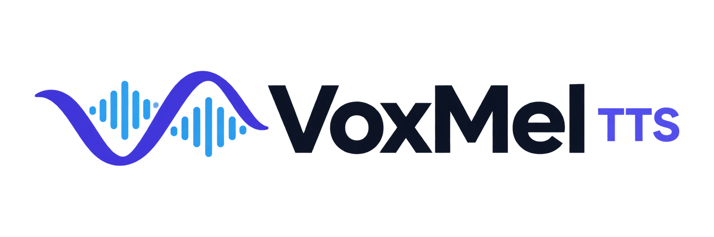
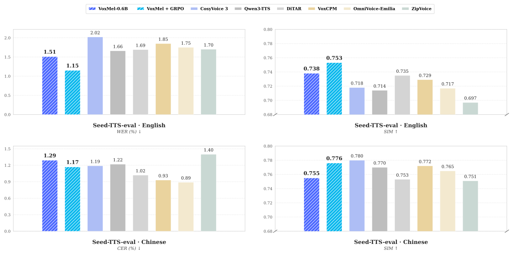
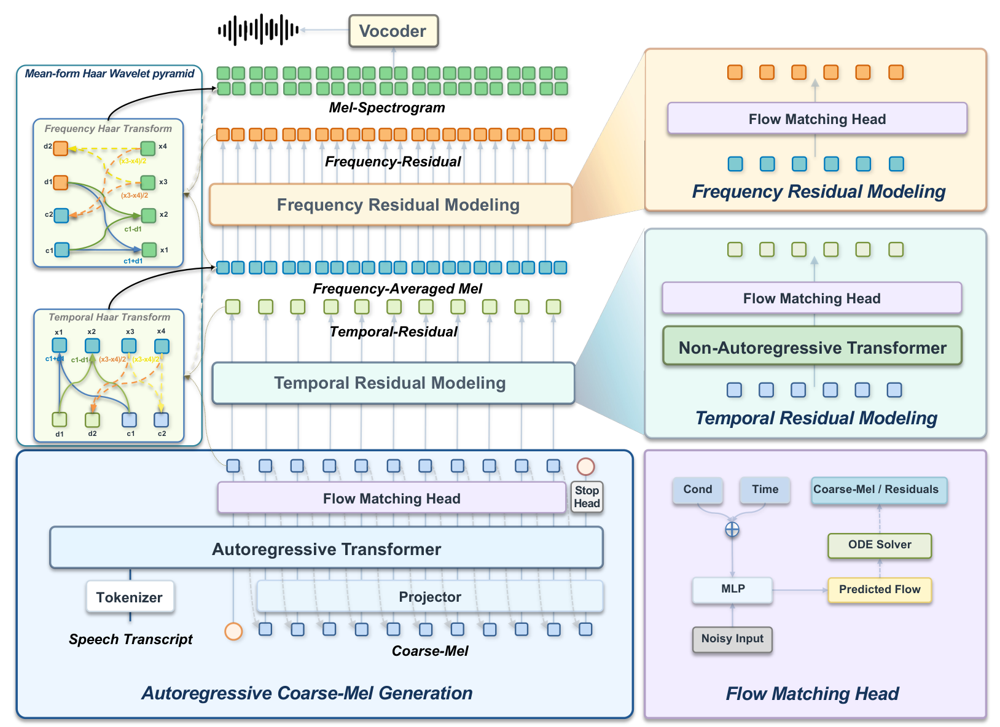

<h2 align="center">VoxMel：ゼロショット音声合成のためのウェーブレット分解に基づく自己回帰メルスペクトログラムモデリング</h2>

<p align="center">
  <b>English</b> | <a href="./README_zh.md">中文</a> | <a href="./README_jap.md">日語</a> | <a href="./README_kor.md">한국어</a>
</p>

<p align="center">
  <picture>
    <source media="(prefers-color-scheme: dark)" srcset="assets/voxmel-logo-dark.png">
    <source media="(prefers-color-scheme: light)" srcset="assets/voxmel-logo.png">
    
  </picture>
</p>

<p align="center">
  📄 <a href="./assets/papers/VoxMel_Technical_Report.pdf">技術レポート</a> &nbsp;|&nbsp;
  🌐 <a href="https://voxdance.github.io/voxmel-demo">プロジェクトページ</a> &nbsp;|&nbsp;
  💻 <a href="https://github.com/VoxDance-Lab/VoxMel">GitHub</a> &nbsp;|&nbsp;
  🤗 <a href="https://huggingface.co/VoxDance-Lab/">Hugging Face</a>
</p>


## 🔥 📰 ニュース

- **2026.11.16** — 技術レポートを公開しました！
- **2026.11.12** — コードとモデルの重み（VoxMel-0.6B / VoxMel-0.3B）を公開しました！

---

**VoxMel** は、固定かつ厳密に可逆な2軸 Haar 変換を通じてメルスペクトログラムを直接モデル化する、音響 tokenizer 不要の連続自己回帰型テキスト音声合成（TTS）フレームワークです。フローマッチングヘッドを備えた言語モデルのバックボーンが **Coarse-Mel** を自己回帰的に生成し、2つの非自己回帰残差階層が時間・周波数の詳細を復元します。これらの詳細は自己回帰の履歴には戻しません。独立した Vocos ボコーダが、復元されたメルスペクトログラムを音声に変換します。

VoxMel は **Emilia の100K時間のデータ**で学習し、英語と中国語のゼロショット音声クローニングで評価しています。**0.6B** の教師ありモデルは Seed-TTS-eval test-en で **1.51% WER / 0.738 SIM** を達成し、ヘッドを凍結した GRPO によって **1.15% WER / 0.753 SIM** に改善します。比較と評価手順は[評価](#-evaluation)をご覧ください。

### ✨ 特長

- **メルスペクトログラムの直接モデリング** — 学習済み音響 tokenizer や圧縮された音響潜在空間を使いません。テキストフロントエンドには Qwen2.5 tokenizer を使用します。
- **厳密に可逆な分解** — 周波数・時間方向の Haar 分解ですべてのメル係数を保持します。厳密な可逆性は変換そのものに対する性質であり、生成音声やボコーダによる復元が無損失であることを保証するものではありません。
- **粗い成分のみの自己回帰** — まず Coarse-Mel を生成し、依存順に時間残差と周波数残差を生成します。残差の詳細は自己回帰履歴に含めません。
- **英語・中国語のゼロショットクローニング** — 参照音声とその書き起こしから音声を合成します。論文の設定では出力は 24 kHz です。

- **事後学習** — ヘッドを凍結した GRPO により、Seed-TTS-eval の4つの指標すべてが改善します。

---

## 目次

- [性能](#performance)
- [モデル構成](#model-architecture)
- [クイックスタート](#-quick-start)
  - [インストール](#installation)
  - [モデルファイルの準備](#prepare-model-files)
  - [Python API](#python-api)
  - [CLI の使い方](#cli-usage)
  - [Web デモ](#web-demo)
- [モデル](#-models)
- [手法](#-method)
- [評価](#-evaluation)
  - [Seed-TTS-eval の結果](#seed-tts-eval-results)
  - [Seed-TTS のバッチ評価](#seed-tts-batch-evaluation)
- [ライセンス](#-license)
- [🤝 コミュニティへの謝辞](#-community-acknowledgments)
- [貢献機関](#-Contributors)
- [引用](#-Citation)

---

<a id="performance"></a>

## 性能



代表的なシステムとの Seed-TTS-eval での比較です。青：教師あり VoxMel-0.6B、シアン：VoxMel-0.6B + GRPO。表全体は[評価](#-evaluation)をご覧ください。

<a id="model-architecture"></a>

## モデル構成




---

<a id="-quick-start"></a>

## 🚀 クイックスタート

<a id="installation"></a>

### インストール

Python 3.10–3.12 を使用してください。ハードウェアに適合し、互いに対応する PyTorch と torchaudio をインストールしてください（元の環境は torch/torchaudio 2.4.1 と CUDA 12.1）。その後、リポジトリのルートでインストールします。

```bash
pip install -e .
```

パッケージのインストーラは `requirements.txt` を共用します。Vocos も含まれています。CPU や Apple Silicon では適切な PyTorch ビルドを使用してください。`device="auto"` は CUDA、MPS、CPU の順で選択します。利用できないデバイスを明示するとエラーになります。MPS の演算子対応と性能は、使用するチェックポイントで検証する必要があります。

<a id="prepare-model-files"></a>

### モデルファイルの準備

このチェックアウトにはモデルコードと Qwen tokenizer が含まれますが、**学習済み VoxMel の重み、実験設定、Vocos の重みは含まれません**。互換性のある実験ファイルを用意してください。

```text
/path/to/experiment/
├── config.yaml
└── model_L_final.pt
/path/to/vocos-mel-24khz/
├── config.yaml
└── pytorch_model.bin
```

<a id="python-api"></a>

### Python API

```python
from voxcore import VoxMel
import soundfile as sf

model = VoxMel.from_pretrained(
    "/path/to/experiment",
    tokenizer_path="examples/voxmel/qwen_tokenizer",
    vocos_path="/path/to/vocos-mel-24khz",
    device="auto",
)

# 音声継続によるクローニングには、参照音声の正確な書き起こしが必要です。
wav = model.generate(
    "这是声音克隆的演示。",
    prompt_wav_path="reference.wav",
    prompt_text="参考音频中实际说出的内容。",
    cfg_text_strength=3.5,
    cfg_spk_strength=3.0,
    seed=42,
)
sf.write("clone.wav", wav, model.sample_rate)
```

API は推論モードで動作し、モノラルの float32 NumPy 波形を返します。`min_seconds` と `max_seconds` は粗いフレームの生成範囲を制御し、実際の長さはモデルの停止予測にも依存します。`cfg_text_strength` と `cfg_spk_strength` はそれぞれテキストと話者のガイダンスを独立に制御し、`up_num_steps` は残差ソルバーのステップ数を設定します。話者ガイダンスは参照音声がある場合のみ適用されます。

<a id="cli-usage"></a>

### CLI の使い方

インストール後、リポジトリのルートで実行します。

```bash
voxmel --model /path/to/experiment \
  --tokenizer-path examples/voxmel/qwen_tokenizer \
  --vocos-path /path/to/vocos-mel-24khz \
  --prompt-audio reference.wav \
  --prompt-text "参考音频转录文本" \
  --text "这是声音克隆的演示。" \
  --cfg-text-strength 3.5 --cfg-spk-strength 3.0 \
  --seed 42 --output out.wav


voxmel --help
```

<a id="web-demo"></a>

### Web デモ

オプションの Gradio 依存関係をインストールし、リポジトリのルートで起動します。

```bash
pip install -e ".[web]"

python app.py \
  --model /path/to/experiment \
  --tokenizer-path examples/voxmel/qwen_tokenizer \
  --vocos-path /path/to/vocos-mel-24khz \
  --device auto \
  --port 8808
```

**http://127.0.0.1:8808** を開きます。デモは音声クローニング専用です。生成するテキストを入力し、参照音声と正確な書き起こしを両方指定するか、`assets/voice_cloning` に同梱されたローカルのサンプルを選択してください。結果は再生し、WAV としてダウンロードできます。画面には英語と中国語のラベルがあり、生成設定ではソルバーのステップ数、長さの範囲、ガイダンスを指定できます。乱数シードは **42** に固定され、各結果に表示されます。

デモは起動時にローカルモデルを一度読み込み、生成リクエストをキューで1件ずつ処理します。モデルと Vocos のファイルは[モデルファイルの準備](#prepare-model-files)に従って用意してください。テキスト CFG と話者 CFG は独立しており、既定値はそれぞれ **3.5** と **3.0** です。粗い成分と残差のソルバーは、どちらも既定で32ステップです。

`--device cpu`、`--device mps`、`--device cuda:0` でデバイスを明示的に選択できます。別のチェックポイント名を指定するには `--checkpoint`、他のマシンからのアクセスを許可するには `--host 0.0.0.0` を使います。すべての起動オプションは `python app.py --help` で確認できます。


---

<a id="-models"></a>

## 📦 モデル

**現在公開されているモデルは VoxMel-0.6B と VoxMel-0.3B です。** 固定 Haar 分解、フローマッチングヘッド、凍結した 24 kHz Vocos ボコーダを使用します。

チェックポイントは Hugging Face の [VoxDance-Lab/VoxMel-0.6B](https://huggingface.co/VoxDance-Lab/VoxMel-0.6B) と [VoxDance-Lab/VoxMel-0.3B](https://huggingface.co/VoxDance-Lab/VoxMel-0.3B) から入手できます。モデルファイルをダウンロードし、[モデルファイルの準備](#prepare-model-files)に従ってローカル推論を設定してください。

**強化学習による事後学習（ヘッドを凍結した GRPO）を行ったのは VoxMel-0.6B のみです。VoxMel-0.3B にはこの事後学習を行っていません。**


---

<a id="-method"></a>

## 💡 手法

### 背景

既存の連続自己回帰型 TTS システムは、高次元の音声生成を扱いやすくするため、学習された音響表現に依存することが一般的です。ニューラル圧縮は自己回帰モデリングを簡単にする一方、表現学習の段階を追加し、復元のボトルネックを生む可能性もあります。

VoxMel は根本的な問いを投げかけます。**高忠実度の連続自己回帰音声生成に、学習による音響圧縮は必要なのでしょうか。**

私たちはメルスペクトログラムを音響モデリングの対象として見直します。重要な観察は、主な課題が必ずしも表現そのものではなく、自己回帰予測のために音響情報をどう整理するかにあるということです。

### 生成パイプライン

1. **メル特徴量の分解：** 周波数軸で周波数平均メル（Frequency-Averaged Mel）と周波数残差に分け、さらに Frequency-Averaged Mel を時間軸で Coarse-Mel と時間残差に分けます。
2. **Coarse-Mel の生成：** デコーダのみの transformer がテキスト、参照音声、過去の粗い単位に基づいてフローマッチングヘッドを条件付けします。
3. **時間方向の詳細の予測：** 非自己回帰階層が Coarse-Mel から時間残差を予測します。時間方向の逆 Haar 変換で Frequency-Averaged Mel を復元します。
4. **周波数方向の詳細の予測：** 第2の階層が、復元した Frequency-Averaged Mel から周波数残差を予測します。周波数方向の逆 Haar 変換で完全なメルスペクトログラムを復元します。
5. **波形合成：** 凍結した Vocos ボコーダがメル特徴量を 24 kHz の音声に変換します。

階層は順に実行され、各階層内の位置は非自己回帰的に予測されます。どちらの残差も Coarse-Mel の履歴には入りません。論文では100チャネルの対数メル、1024点の FFT／窓長、256サンプルのホップ、24 kHz のサンプリング周波数を使用します。完全なメルのフレームレートは 93.75 Hz、Coarse-Mel は 46.875 Hz です。


---

<a id="-evaluation"></a>

## 📊 評価

<a id="seed-tts-eval-results"></a>

### Seed-TTS-eval の結果

ゼロショット音声クローニングの結果です。WER/CER は百分率（低いほど良い）、SIM は話者埋め込みのコサイン類似度（高いほど良い）です。太字は各列の最良値を示します。
| モデル | パラメータ数 | 学習時間 | EN WER ↓ (%) | EN SIM ↑ | ZH CER ↓ (%) | ZH SIM ↑ |
| --- | ---: | ---: | ---: | ---: | ---: | ---: |
| CosyVoice | 0.3B | 170K | 3.39 | 0.629 | 3.63 | 0.723 |
| CosyVoice 2 | 0.5B | 167K | 2.57 | 0.652 | 1.45 | 0.748 |
| CosyVoice 3 | 1.1B | 1.0M | 2.02 | 0.718 | 1.19 | **0.780** |
| Spark-TTS | 0.5B | 102K | 1.98 | 0.584 | 1.20 | 0.672 |
| MaskGCT | 1.0B | 100K | 2.88 | 0.713 | 2.40 | 0.773 |
| FireRedTTS 2 | 1.5B | 1.4M | 1.95 | 0.665 | 1.14 | 0.736 |
| Qwen3-TTS | 1.7B | 5.0M | 1.66 | 0.714 | 1.22 | 0.770 |
| IndexTTS 2 | 1.7B | 55K | 2.23 | 0.706 | 1.03 | 0.765 |
| VibeVoice | 1.5B | — | 3.04 | 0.689 | 1.16 | 0.744 |
| MOSS-TTS | 8.0B | — | 1.84 | 0.709 | 1.37 | 0.770 |
| MOSS-TTS-Nano | 0.1B | — | 4.62 | 0.499 | 3.13 | 0.643 |
| DiTAR | 0.6B | 280K | 1.69 | 0.735 | 1.02 | 0.753 |
| VoxCPM | 0.7B | 1.8M | 1.85 | 0.729 | 0.93 | 0.772 |
| OmniVoice-Emilia | 0.8B | 100K | 1.75 | 0.717 | **0.89** | 0.765 |
| E2-TTS (32 NFE) | 0.3B | 100K | 2.32 | 0.706 | 1.91 | 0.713 |
| F5-TTS (32 NFE) | 0.3B | 100K | 1.85 | 0.664 | 1.53 | 0.750 |
| ZipVoice (16 NFE) | 0.1B | 100K | 1.70 | 0.697 | 1.40 | 0.751 |
| **VoxMel-0.6B** | 0.6B | 100K | 1.51 | 0.738 | 1.29 | 0.755 |
| **VoxMel-0.6B + GRPO** | 0.6B | 100K | **1.15** | **0.753** | 1.17 | 0.776 |

列挙した既存システムと比べ、教師あり VoxMel モデルは英語 WER が最も低く、英語 SIM が最も高い値を示します。GRPO により両指標がさらに改善します。

<a id="seed-tts-batch-evaluation"></a>

### Seed-TTS のバッチ評価

```bash
cd examples/voxmel
EXP_DIR=/path/to/experiment VOCOS_PATH=/path/to/vocos-mel-24khz \
TESTSET=/path/to/seedtts_testset bash infer_seedtts_voxmel.sh
```

テストセットには `zh/meta.lst` と `en/meta.lst` が含まれ、各行の形式は
`id|prompt transcript|prompt audio path|target text` です。音声パスは各言語ディレクトリからの相対パスです。スクリプトは環境変数による `GPU`、`NPROC`、`MAX_ITEMS`、`COARSE_STEPS`、`UP_STEPS`、CFG の上書きに対応し、既存の出力はスキップします。CUDA を使わない推論では `DEVICE=cpu` または `DEVICE=mps` と `NPROC=1` を指定してください。


---

<a id="-community-acknowledgments"></a>

## 🤝 コミュニティへの謝辞

> [!TIP]
> **Apple Silicon Mac で VoxMel をネイティブ実行**
>
> Apple の MLX フレームワークで VoxMel のコミュニティ移植版を開発してくださった [@vanch007](https://github.com/vanch007) に感謝します。BF16、8-bit、4-bit の重みを使ったローカル推論に対応しています。
>
> **[mlx-voxmel を見て使い始める →](https://github.com/vanch007/mlx-voxmel)**


---

<a id="-license"></a>

## 📄 ライセンス

VoxMel のコードとモデルの重みは [Apache License 2.0](https://www.apache.org/licenses/LICENSE-2.0) で公開しています。サードパーティ製コンポーネントには、それぞれのライセンスが引き続き適用されます。

---

<p align="center">
  開発
  <br><br>
  
  <br>
  <b>VoxDance Lab</b>
</p>


---

<a id="-Contributors"></a>

## 貢献機関

<p align="center">
  以下の機関の貢献に深く感謝します。
</p>

<table align="center">
  <tr>
    <td align="center" valign="middle" width="210">
      
      <br><sub>上海創智学院</sub>
    </td>
    <td align="center" valign="middle" width="210">
      
      <br><sub>厦門大学</sub>
    </td>
    <td align="center" valign="middle" width="210">
      
      <br><sub>上海交通大学</sub>
    </td>
  </tr>
  <tr>
    <td align="center" valign="middle">
      
      <br><sub>復旦大学</sub>
    </td>
    <td align="center" valign="middle">
      
      <br><sub>浙江大学</sub>
    </td>
    <td align="center" valign="middle">
      
      <br><sub>京都大学</sub>
    </td>
  </tr>
</table>


---

<a id="-Citation"></a>

## 📖 引用

VoxMel が研究や業務に役立った場合は、技術レポートの引用をご検討ください。

```bibtex
@misc{guan2026voxmel,
  title  = {VoxMel TTS Technical Report},
  author = {Guan, Wenhao and Ye, Jiaxin and Li, Haitao and Duan, Yifan and
            Liu, Junxi and Zhou, Wangjin and Li, Lin and Hong, Qingyang and Chen, Xie},
  year   = {2026},
  eprint        = {2611.20254},
  archivePrefix = {arXiv},
  url           = {https://arxiv.org/abs/2611.20254}
}
```


