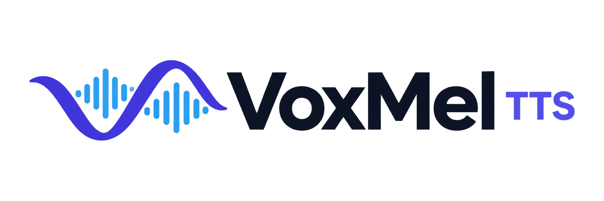
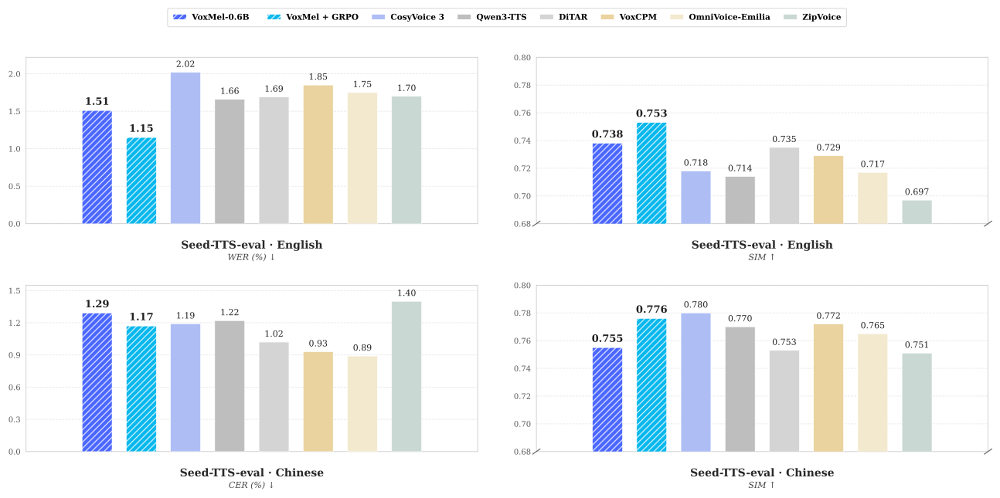
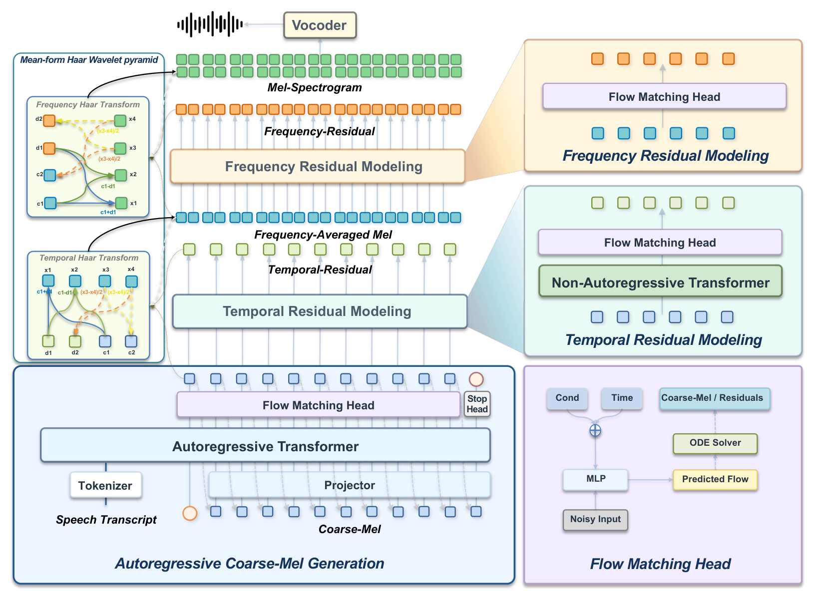

<h2 align="center">VoxMel: Wavelet-Factorized Autoregressive Mel-Spectrogram Modeling for Zero-Shot Speech Synthesis</h2>

<p align="center">
  <a href="./README.md">English</a> | <a href="./README_zh.md">中文</a> | <b>日本語</b> | <a href="./README_kor.md">한국어</a>
</p>

<p align="center">
  <picture>
    <source media="(prefers-color-scheme: dark)" srcset="assets/voxmel-logo-dark.png">
    <source media="(prefers-color-scheme: light)" srcset="assets/voxmel-logo.png">
    
  </picture>
</p>

<p align="center">
  Technical Report (coming soon) |
  <a href="https://voxdance.github.io/voxmel-demo">Project Page</a> |
  <a href="https://github.com/VoxDance-Lab/voxmel">GitHub</a> |
  <a href="https://huggingface.co/VoxDance-Lab/VoxMel-0.6B">Hugging Face</a>
</p>

**VoxMel** は、固定かつ厳密に可逆な2軸 Haar 変換を用いてメルスペクトログラムを直接モデル化する、音響トークナイザー不要の連続自己回帰型テキスト音声合成（TTS）フレームワークです。言語モデルのバックボーンとフローマッチングヘッドが **Coarse-Mel** を自己回帰的に生成し、2つの非自己回帰残差層が時間・周波数の細部を復元します。残差は自己回帰の履歴に戻されません。独立した Vocos ボコーダーが復元されたメルスペクトログラムを波形に変換します。

VoxMel は **Emilia の10万時間のデータ**で学習し、英語と中国語のゼロショット音声クローニングで評価しています。**0.6B** の教師ありモデルは Seed-TTS-eval test-en で **1.51% WER / 0.738 SIM** を達成し、ヘッドを凍結した GRPO により **1.15% WER / 0.753 SIM** に改善します。比較結果と評価プロトコルは[評価](#evaluation)をご覧ください。

<a id="highlights"></a>

### ✨ 主な特徴

- **メルの直接モデル化** — 学習済み音響トークナイザーや圧縮音響潜在空間は不要です。テキスト側には Qwen2.5 トークナイザーを使用します。
- **厳密に可逆な分解** — 周波数軸と時間軸の Haar 分解はすべてのメル係数を保持します。可逆性は変換自体の性質であり、生成音声やボコーダーの復元が無損失であることを保証するものではありません。
- **粗い成分のみを自己回帰生成** — Coarse-Mel、時間残差、周波数残差の順に生成します。残差の細部は自己回帰の履歴に入りません。
- **英語・中国語のゼロショット音声クローニング** — 参照音声とその書き起こしから合成します。論文の設定では24 kHzで出力します。

- **事後学習** — ヘッドを凍結した GRPO により、Seed-TTS の4指標すべてが改善します。

---

<a id="contents"></a>

## 目次

- [性能](#performance)
- [モデルアーキテクチャ](#model-architecture)
- [クイックスタート](#quick-start)
  - [インストール](#installation)
  - [モデルファイルの準備](#prepare-model-files)
  - [Python API](#python-api)
  - [CLI の使い方](#cli-usage)
  - [Web デモ](#web-demo)
- [モデル](#models)
- [手法](#method)
- [評価](#evaluation)
  - [Seed-TTS-eval の結果](#seed-tts-eval-results)
  - [Seed-TTS バッチ評価](#seed-tts-batch-evaluation)
- [ライセンス](#license)

---

<a id="performance"></a>

## 性能



代表的なシステムとの Seed-TTS-eval 比較です。青は教師あり VoxMel-0.6B、水色は VoxMel-0.6B + GRPO です。全結果は[評価](#evaluation)をご覧ください。

<a id="model-architecture"></a>

## モデルアーキテクチャ



---

<a id="quick-start"></a>

## 🚀 クイックスタート

<a id="installation"></a>

### インストール

Python 3.10–3.12 を使用してください。ハードウェアに合った互換性のある PyTorch と torchaudio をインストールし（元の環境は torch/torchaudio 2.4.1、CUDA 12.1）、リポジトリのルートから実行します。

```bash
pip install -e .
```

パッケージのインストーラーは `requirements.txt` を共用し、Vocos も含まれます。CPU や Apple Silicon には対応する PyTorch ビルドを使用してください。`device="auto"` は CUDA、MPS、CPU の順に選択します。利用できないデバイスを明示するとエラーになります。MPS の演算子対応と性能は、実際のチェックポイントで検証する必要があります。

<a id="prepare-model-files"></a>

### モデルファイルの準備

このチェックアウトにはモデルのコードと Qwen トークナイザーが含まれますが、**学習済み VoxMel 重み、実験設定、Vocos 重みは含まれません**。互換性のある実験ファイルを用意してください。

```text
/path/to/experiment/
├── config.yaml
└── model_L_final.pt
/path/to/vocos-mel-24khz/
├── config.yaml
└── pytorch_model.bin
```

<a id="python-api"></a>

### Python API

```python
from voxcore import VoxMel
import soundfile as sf

model = VoxMel.from_pretrained(
    "/path/to/experiment",
    tokenizer_path="examples/voxmel/qwen_tokenizer",
    vocos_path="/path/to/vocos-mel-24khz",
    device="auto",
)

# 音声継続によるクローニングには参照音声の正確な書き起こしが必要です。
wav = model.generate(
    "这是声音克隆的演示。",
    prompt_wav_path="reference.wav",
    prompt_text="参考音频中实际说出的内容。",
    cfg_text_strength=3.5,
    cfg_spk_strength=3.0,
    seed=42,
)
sf.write("clone.wav", wav, model.sample_rate)
```

API は推論モードで動作し、モノラルの float32 NumPy 波形を返します。`min_seconds` と `max_seconds` は Coarse-Mel の生成フレーム数の範囲を制御し、実際の長さはモデルの停止予測にも依存します。`cfg_text_strength` と `cfg_spk_strength` はテキストと話者のガイダンス強度をそれぞれ制御し、`up_num_steps` は残差ソルバーのステップ数を指定します。話者ガイダンスは参照音声を指定した場合にのみ適用されます。

<a id="cli-usage"></a>

### CLI の使い方

インストール後、リポジトリのルートから実行します。

```bash
voxmel --model /path/to/experiment \
  --tokenizer-path examples/voxmel/qwen_tokenizer \
  --vocos-path /path/to/vocos-mel-24khz \
  --prompt-audio reference.wav \
  --prompt-text "参考音频转录文本" \
  --text "这是声音克隆的演示。" \
  --cfg-text-strength 3.5 --cfg-spk-strength 3.0 \
  --seed 42 --output out.wav

voxmel --help
```

<a id="web-demo"></a>

### Web デモ

オプションの Gradio 依存関係をインストールし、リポジトリのルートから起動します。

```bash
pip install -e ".[web]"

python app.py \
  --model /path/to/experiment \
  --tokenizer-path examples/voxmel/qwen_tokenizer \
  --vocos-path /path/to/vocos-mel-24khz \
  --device auto \
  --port 8808
```

**http://127.0.0.1:8808** を開きます。このデモは音声クローニング専用です。合成したいテキストと、参照音声およびその正確な書き起こしを入力するか、`assets/voice_cloning` に同梱されたローカルのサンプルを選択してください。生成した音声は再生でき、WAV ファイルとしてダウンロードできます。画面には英語と中国語のラベルがあり、ソルバーのステップ数、生成時間の範囲、ガイダンス強度を設定できます。現在の `app.py` では乱数シードは **0** に固定され、結果とともに表示されます。

ローカルモデルは起動時に一度だけ読み込まれ、生成リクエストはキューで1件ずつ処理されます。[モデルファイルの準備](#prepare-model-files)に従って、モデルと Vocos のファイルを用意してください。テキスト CFG と話者 CFG は独立して設定でき、既定値はそれぞれ **3.5** と **3.0** です。Coarse-Mel と残差のソルバーステップ数は、いずれも既定値が **32** です。

`--device cpu`、`--device mps`、`--device cuda:0` でデバイスを明示できます。`--checkpoint` で別のチェックポイント名を指定し、`--host 0.0.0.0` で他のマシンからのアクセスを許可できます。全起動オプションは `python app.py --help` を参照してください。

---

<a id="models"></a>

## 📦 モデル

**現在オープンソースとして公開しているモデルサイズは VoxMel-0.6B のみです。** 固定 Haar 分解、フローマッチングヘッド、凍結した24 kHz Vocos ボコーダーを使用します。

チェックポイントは Hugging Face の [VoxDance-Lab/VoxMel-0.6B](https://huggingface.co/VoxDance-Lab/VoxMel-0.6B) で公開されています。モデルファイルをダウンロードし、[モデルファイルの準備](#prepare-model-files)に従ってローカル推論を設定してください。


**強化学習による事後学習（ヘッドを凍結した GRPO）を行ったのは VoxMel-0.6B のみです。VoxMel-0.3B にはこの事後学習を行っていません。**


---

<a id="method"></a>

## 💡 手法

<a id="motivation"></a>

### 背景と動機

既存の連続自己回帰型 TTS は、高次元音声の生成を扱いやすくするため、学習済み音響表現に依存することが一般的です。ニューラル圧縮は自己回帰モデル化を簡単にする一方、表現学習の段階を追加し、復元のボトルネックになる可能性があります。

VoxMel は次の基本的な問いを検討します。**高忠実度の連続自己回帰音声生成に、学習による音響圧縮は必要なのでしょうか。**

私たちはメルスペクトログラムを音響モデルの対象として再検討します。主要な課題は表現そのものよりも、自己回帰予測に向けた音響情報の構成方法にあるという点が重要な観察です。

<a id="generation-pipeline"></a>

### 生成パイプライン

1. **メル特徴の分解：** 周波数軸に沿って周波数平均メルと周波数残差に分け、周波数平均メルを時間軸に沿って Coarse-Mel と時間残差に分けます。
2. **Coarse-Mel の生成：** デコーダーのみの Transformer が、テキスト、参照音声、過去の粗い成分に基づきフローマッチングヘッドを条件付けします。
3. **時間方向の細部の予測：** 非自己回帰層が Coarse-Mel から時間残差を予測し、時間軸の逆 Haar 変換で周波数平均メルを復元します。
4. **周波数方向の細部の予測：** 第2層が復元された周波数平均メルから周波数残差を予測し、周波数軸の逆 Haar 変換で完全なメルを復元します。
5. **波形の合成：** 凍結した Vocos ボコーダーがメル特徴を24 kHz音声に変換します。

残差層は順番に実行しますが、各層内の位置は非自己回帰的に予測します。どちらの残差も Coarse-Mel の履歴には入りません。論文では24 kHz、100チャネルの対数メル、FFT・窓長1024、ホップ長256サンプルを使用します。フレームレートは完全なメルで93.75 Hz、Coarse-Mel で46.875 Hzです。

---

<a id="evaluation"></a>

## 📊 評価

<a id="seed-tts-eval-results"></a>

### Seed-TTS-eval の結果

ゼロショット音声クローニングの結果です。WER/CER は百分率で低いほど良く、SIM は話者埋め込みのコサイン類似度で高いほど良い指標です。太字はこの表の各列の最良値、「—」は報告に値の記載がないことを示します。

| モデル | パラメーター数 | 学習時間数 | EN WER ↓ (%) | EN SIM ↑ | ZH CER ↓ (%) | ZH SIM ↑ |
| --- | ---: | ---: | ---: | ---: | ---: | ---: |
| CosyVoice | 0.3B | 170K | 3.39 | 0.629 | 3.63 | 0.723 |
| CosyVoice 2 | 0.5B | 167K | 2.57 | 0.652 | 1.45 | 0.748 |
| CosyVoice 3 | 1.1B | 1.0M | 2.02 | 0.718 | 1.19 | **0.780** |
| Spark-TTS | 0.5B | 102K | 1.98 | 0.584 | 1.20 | 0.672 |
| MaskGCT | 1.0B | 100K | 2.88 | 0.713 | 2.40 | 0.773 |
| FireRedTTS 2 | 1.5B | 1.4M | 1.95 | 0.665 | 1.14 | 0.736 |
| Qwen3-TTS | 1.7B | 5.0M | 1.66 | 0.714 | 1.22 | 0.770 |
| IndexTTS 2 | 1.7B | 55K | 2.23 | 0.706 | 1.03 | 0.765 |
| VibeVoice | 1.5B | — | 3.04 | 0.689 | 1.16 | 0.744 |
| MOSS-TTS | 8.0B | — | 1.84 | 0.709 | 1.37 | 0.770 |
| MOSS-TTS-Nano | 0.1B | — | 4.62 | 0.499 | 3.13 | 0.643 |
| DiTAR | 0.6B | 280K | 1.69 | 0.735 | 1.02 | 0.753 |
| VoxCPM | 0.7B | 1.8M | 1.85 | 0.729 | 0.93 | 0.772 |
| OmniVoice-Emilia | 0.8B | 100K | 1.75 | 0.717 | **0.89** | 0.765 |
| E2-TTS (32 NFE) | 0.3B | 100K | 2.32 | 0.706 | 1.91 | 0.713 |
| F5-TTS (32 NFE) | 0.3B | 100K | 1.85 | 0.664 | 1.53 | 0.750 |
| ZipVoice (16 NFE) | 0.1B | 100K | 1.70 | 0.697 | 1.40 | 0.751 |
| **VoxMel-0.6B** | 0.6B | 100K | 1.51 | 0.738 | 1.29 | 0.755 |
| **VoxMel-0.6B + GRPO** | 0.6B | 100K | **1.15** | **0.753** | 1.17 | 0.776 |

教師あり VoxMel は、掲載した既存システムの中で英語 WER が最も低く、英語 SIM が最も高い結果です。GRPO により両指標がさらに改善します。

<a id="seed-tts-batch-evaluation"></a>

### Seed-TTS バッチ評価

```bash
cd examples/voxmel
EXP_DIR=/path/to/experiment VOCOS_PATH=/path/to/vocos-mel-24khz \
TESTSET=/path/to/seedtts_testset bash infer_seedtts_voxmel.sh
```

テストセットには `zh/meta.lst` と `en/meta.lst` があり、各行の形式は `id|参照音声の書き起こし|参照音声パス|対象テキスト` です。音声パスは各言語ディレクトリからの相対パスです。スクリプトは `GPU`、`NPROC`、`MAX_ITEMS`、`COARSE_STEPS`、`UP_STEPS`、CFG の環境変数による上書きに対応し、既存の出力をスキップします。CUDA 以外では `DEVICE=cpu` または `DEVICE=mps` と `NPROC=1` を指定してください。

---

<a id="license"></a>

## 📄 ライセンス

VoxMel のコードとモデル重みは [Apache License 2.0](https://www.apache.org/licenses/LICENSE-2.0) の下で公開されています。サードパーティーのコンポーネントには、それぞれのライセンスが引き続き適用されます。

---

<p align="center">
  開発
  <br><br>
  
  <br>
  <b>VoxDance Lab</b>
</p>
