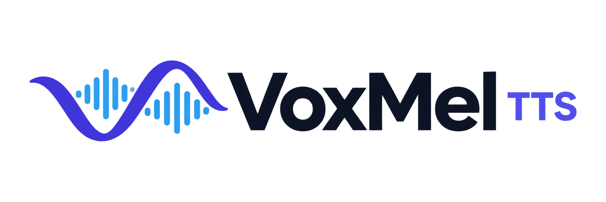
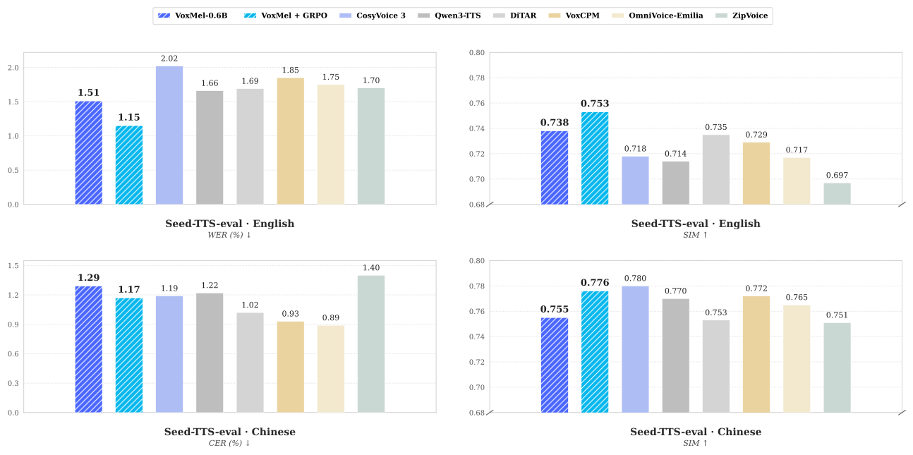
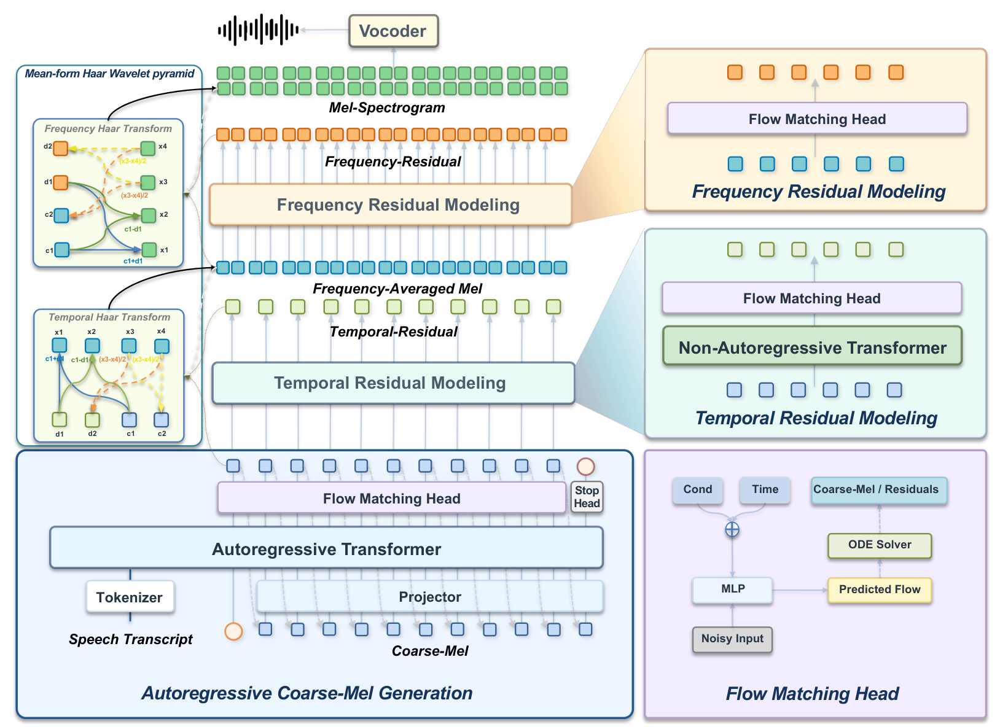

<h2 align="center">VoxMel: Wavelet-Factorized Autoregressive Mel-Spectrogram Modeling for Zero-Shot Speech Synthesis</h2>

<p align="center">
  <a href="./README.md">English</a> | <a href="./README_zh.md">中文</a> | <a href="./README_jap.md">日本語</a> | <b>한국어</b>
</p>

<p align="center">
  <picture>
    <source media="(prefers-color-scheme: dark)" srcset="assets/voxmel-logo-dark.png">
    <source media="(prefers-color-scheme: light)" srcset="assets/voxmel-logo.png">
    
  </picture>
</p>

<p align="center">
  Technical Report (coming soon) |
  <a href="https://voxdance.github.io/voxmel-demo">Project Page</a> |
  <a href="https://github.com/VoxDance-Lab/voxmel">GitHub</a> |
  <a href="https://huggingface.co/VoxDance-Lab/VoxMel-0.6B">Hugging Face</a>
</p>

**VoxMel**은 고정된 정확히 가역적인 2축 Haar 변환으로 멜 스펙트로그램을 직접 모델링하는, 음향 토크나이저가 필요 없는 연속 자기회귀 텍스트 음성 합성(TTS) 프레임워크입니다. 언어 모델 백본과 플로 매칭 헤드가 **Coarse-Mel**을 자기회귀 방식으로 생성하며, 두 비자기회귀 잔차 계층이 시간 및 주파수 세부 정보를 복원합니다. 잔차는 자기회귀 이력에 다시 입력되지 않습니다. 별도의 Vocos 보코더가 복원된 멜 스펙트로그램을 파형으로 변환합니다.

VoxMel은 **Emilia 데이터 10만 시간**으로 학습되었으며 영어 및 중국어 제로샷 음성 복제로 평가했습니다. **0.6B** 지도 학습 모델은 Seed-TTS-eval test-en에서 **1.51% WER / 0.738 SIM**을 달성하며, 헤드를 고정한 GRPO 적용 시 **1.15% WER / 0.753 SIM**으로 개선됩니다. 비교 결과와 평가 프로토콜은 [평가](#evaluation)를 참고하세요.

<a id="highlights"></a>

### ✨ 주요 특징

- **직접적인 멜 모델링** — 학습된 음향 토크나이저나 압축 음향 잠재 공간이 필요하지 않습니다. 텍스트 프런트엔드는 Qwen2.5 토크나이저를 사용합니다.
- **정확히 가역적인 분해** — 주파수 및 시간축 Haar 분해는 모든 멜 계수를 보존합니다. 가역성은 변환 자체에 해당하며 생성 음성이나 보코더 복원의 무손실성을 보장하지 않습니다.
- **거친 성분만 자기회귀 생성** — Coarse-Mel을 먼저 생성한 뒤 시간 잔차와 주파수 잔차를 의존 순서대로 생성합니다. 세부 잔차는 자기회귀 이력에 포함되지 않습니다.
- **영어·중국어 제로샷 음성 복제** — 참조 음성과 전사문으로 음성을 합성합니다. 논문 설정에서는 24 kHz로 출력합니다.

- **사후 학습** — 헤드를 고정한 GRPO로 Seed-TTS의 네 가지 지표가 모두 개선됩니다.

---

<a id="contents"></a>

## 목차

- [성능](#performance)
- [모델 아키텍처](#model-architecture)
- [빠른 시작](#quick-start)
  - [설치](#installation)
  - [모델 파일 준비](#prepare-model-files)
  - [Python API](#python-api)
  - [CLI 사용법](#cli-usage)
  - [Web 데모](#web-demo)
- [모델](#models)
- [방법](#method)
- [평가](#evaluation)
  - [Seed-TTS-eval 결과](#seed-tts-eval-results)
  - [Seed-TTS 배치 평가](#seed-tts-batch-evaluation)
- [라이선스](#license)

---

<a id="performance"></a>

## 성능



주요 시스템과의 Seed-TTS-eval 비교입니다. 파란색은 지도 학습 VoxMel-0.6B, 청록색은 VoxMel-0.6B + GRPO입니다. 전체 결과는 [평가](#evaluation)를 참고하세요.

<a id="model-architecture"></a>

## 모델 아키텍처



---

<a id="quick-start"></a>

## 🚀 빠른 시작

<a id="installation"></a>

### 설치

Python 3.10–3.12를 사용하세요. 하드웨어에 맞는 호환 가능한 PyTorch와 torchaudio를 설치한 뒤(원래 환경은 torch/torchaudio 2.4.1, CUDA 12.1) 저장소 루트에서 설치합니다.

```bash
pip install -e .
```

패키지 설치 프로그램은 `requirements.txt`를 함께 사용하며 Vocos가 포함됩니다. CPU 또는 Apple Silicon에서는 적절한 PyTorch 빌드를 사용하세요. `device="auto"`는 CUDA, MPS, CPU 순으로 선택합니다. 사용할 수 없는 장치를 명시하면 오류가 발생합니다. MPS 연산자 지원 및 성능은 실제 체크포인트로 검증해야 합니다.

<a id="prepare-model-files"></a>

### 모델 파일 준비

이 체크아웃에는 모델 코드와 Qwen 토크나이저가 포함되지만 **학습된 VoxMel 가중치, 실험 설정, Vocos 가중치는 포함되지 않습니다**. 호환되는 실험 파일을 준비하세요.

```text
/path/to/experiment/
├── config.yaml
└── model_L_final.pt
/path/to/vocos-mel-24khz/
├── config.yaml
└── pytorch_model.bin
```

<a id="python-api"></a>

### Python API

```python
from voxcore import VoxMel
import soundfile as sf

model = VoxMel.from_pretrained(
    "/path/to/experiment",
    tokenizer_path="examples/voxmel/qwen_tokenizer",
    vocos_path="/path/to/vocos-mel-24khz",
    device="auto",
)

# 음성 이어 생성 방식의 복제에는 참조 음성의 정확한 전사문이 필요합니다.
wav = model.generate(
    "这是声音克隆的演示。",
    prompt_wav_path="reference.wav",
    prompt_text="参考音频中实际说出的内容。",
    cfg_text_strength=3.5,
    cfg_spk_strength=3.0,
    seed=42,
)
sf.write("clone.wav", wav, model.sample_rate)
```

API는 추론 모드에서 실행되며 모노 float32 NumPy 파형을 반환합니다. `min_seconds`와 `max_seconds`는 Coarse-Mel의 생성 프레임 수 범위를 제어하며, 실제 길이는 모델의 종료 예측에도 영향을 받습니다. `cfg_text_strength`와 `cfg_spk_strength`는 각각 텍스트와 화자 가이던스 강도를 제어하고, `up_num_steps`는 잔차 솔버 단계 수를 설정합니다. 화자 가이던스는 참조 음성이 제공된 경우에만 적용됩니다.

<a id="cli-usage"></a>

### CLI 사용법

설치 후 저장소 루트에서 실행하세요.

```bash
voxmel --model /path/to/experiment \
  --tokenizer-path examples/voxmel/qwen_tokenizer \
  --vocos-path /path/to/vocos-mel-24khz \
  --prompt-audio reference.wav \
  --prompt-text "参考音频转录文本" \
  --text "这是声音克隆的演示。" \
  --cfg-text-strength 3.5 --cfg-spk-strength 3.0 \
  --seed 42 --output out.wav

voxmel --help
```

<a id="web-demo"></a>

### Web 데모

선택적 Gradio 의존성을 설치하고 저장소 루트에서 실행하세요.

```bash
pip install -e ".[web]"

python app.py \
  --model /path/to/experiment \
  --tokenizer-path examples/voxmel/qwen_tokenizer \
  --vocos-path /path/to/vocos-mel-24khz \
  --device auto \
  --port 8808
```

**http://127.0.0.1:8808** 에 접속하세요. 이 데모는 음성 복제만 지원합니다. 합성할 텍스트와 함께 참조 음성 및 정확한 전사문을 입력하거나, `assets/voice_cloning`에 포함된 로컬 예제를 선택하세요. 생성된 음성은 재생하거나 WAV 파일로 다운로드할 수 있습니다. 인터페이스에는 영어와 중국어 레이블이 표시되며, 생성 설정에서 솔버 단계 수, 생성 길이 범위, 가이던스 강도를 조정할 수 있습니다. 현재 `app.py`의 난수 시드는 **0**으로 고정되어 있으며 결과와 함께 표시됩니다.

로컬 모델은 시작할 때 한 번만 로드하며, 생성 요청은 대기열에서 한 번에 하나씩 처리합니다. [모델 파일 준비](#prepare-model-files)에 따라 모델과 Vocos 파일을 준비하세요. 텍스트 CFG와 화자 CFG는 독립적으로 설정하며 기본값은 각각 **3.5**, **3.0**입니다. Coarse-Mel과 잔차 솔버의 기본 단계 수는 모두 **32**입니다.

`--device cpu`, `--device mps`, `--device cuda:0`으로 장치를 명시할 수 있습니다. `--checkpoint`로 다른 체크포인트 파일명을 지정하고, `--host 0.0.0.0`으로 다른 장치에서 접근하도록 설정할 수 있습니다. 전체 실행 옵션은 `python app.py --help`를 참고하세요.

---

<a id="models"></a>

## 📦 모델

**현재 오픈소스로 공개된 모델 크기는 VoxMel-0.6B뿐입니다.** 고정 Haar 분해, 플로 매칭 헤드, 고정된 24 kHz Vocos 보코더를 사용합니다.

체크포인트는 Hugging Face의 [VoxDance-Lab/VoxMel-0.6B](https://huggingface.co/VoxDance-Lab/VoxMel-0.6B)에서 받을 수 있습니다. 모델 파일을 다운로드한 뒤 [모델 파일 준비](#prepare-model-files)에 따라 로컬 추론 환경을 설정하세요.

| 구성 | VoxMel-0.6B |
| --- | ---: |
| 총 파라미터 수(보코더 제외) | 690.1M |
| 백본 레이어 수 | 24 |
| 백본 너비 | 896 |
| 백본 FFN 너비 | 4864 |
| 잔차 계층 너비 | 1024 |
| 계층별 블록 수 | 6 |
| 플로 헤드 레이어 수 | 6 |
| 학습 데이터 | 10만 시간 |

0.6B 백본은 Qwen2.5-0.5B로 초기화합니다. 파라미터 구성은 백본 494.0M, Coarse-Mel 헤드 14.8M, 시간 잔차 계층 90.6M, 주파수 잔차 계층 90.6M, 어댑터 0.1M입니다. 고정된 Vocos 보코더의 13.6M 파라미터는 위 총계에 포함되지 않습니다.

---

<a id="method"></a>

## 💡 방법

<a id="motivation"></a>

### 연구 동기

기존 연속 자기회귀 TTS 시스템은 고차원 음성 생성을 다루기 위해 학습된 음향 표현에 의존하는 경우가 많습니다. 신경망 압축은 자기회귀 모델링을 단순화하지만 추가적인 표현 학습 단계를 도입하며 복원 병목을 만들 수 있습니다.

VoxMel은 다음의 근본적인 질문을 탐구합니다. **고충실도 연속 자기회귀 음성 생성에 학습된 음향 압축이 반드시 필요할까요?**

우리는 멜 스펙트로그램을 음향 모델링 대상으로 다시 살펴봅니다. 핵심 관찰은 주된 과제가 표현 자체보다 자기회귀 예측을 위해 음향 정보를 구성하는 방식에 있을 수 있다는 점입니다.

<a id="generation-pipeline"></a>

### 생성 과정

1. **멜 특징 분해:** 주파수축을 따라 주파수 평균 멜과 주파수 잔차로 분리한 뒤, 주파수 평균 멜을 시간축을 따라 Coarse-Mel과 시간 잔차로 나눕니다.
2. **Coarse-Mel 생성:** 디코더 전용 Transformer가 텍스트, 참조 음성, 이전 거친 단위를 바탕으로 플로 매칭 헤드에 조건을 제공합니다.
3. **시간 세부 정보 예측:** 비자기회귀 계층이 Coarse-Mel에서 시간 잔차를 예측하며, 시간축 역 Haar 변환으로 주파수 평균 멜을 복원합니다.
4. **주파수 세부 정보 예측:** 두 번째 계층이 복원된 주파수 평균 멜에서 주파수 잔차를 예측하고 주파수축 역 Haar 변환으로 전체 멜 스펙트로그램을 복원합니다.
5. **파형 합성:** 고정된 Vocos 보코더가 멜 특징을 24 kHz 음성으로 변환합니다.

잔차 계층은 순서대로 실행되지만 각 계층 내 위치는 비자기회귀 방식으로 예측합니다. 두 잔차 모두 Coarse-Mel 이력에 포함되지 않습니다. 논문은 24 kHz에서 100채널 로그 멜, FFT/윈도 길이 1024, 홉 길이 256샘플을 사용합니다. 전체 멜 프레임 레이트는 93.75 Hz, Coarse-Mel은 46.875 Hz입니다.

---

<a id="evaluation"></a>

## 📊 평가

<a id="seed-tts-eval-results"></a>

### Seed-TTS-eval 결과

제로샷 음성 복제 결과입니다. WER/CER는 백분율로 낮을수록 좋으며, SIM은 화자 임베딩의 코사인 유사도로 높을수록 좋습니다. 굵은 수치는 표의 각 열에서 가장 좋은 결과이며 “—”는 보고서에 값이 없음을 뜻합니다.

| 모델 | 파라미터 수 | 학습 시간 | EN WER ↓ (%) | EN SIM ↑ | ZH CER ↓ (%) | ZH SIM ↑ |
| --- | ---: | ---: | ---: | ---: | ---: | ---: |
| CosyVoice | 0.3B | 170K | 3.39 | 0.629 | 3.63 | 0.723 |
| CosyVoice 2 | 0.5B | 167K | 2.57 | 0.652 | 1.45 | 0.748 |
| CosyVoice 3 | 1.1B | 1.0M | 2.02 | 0.718 | 1.19 | **0.780** |
| Spark-TTS | 0.5B | 102K | 1.98 | 0.584 | 1.20 | 0.672 |
| MaskGCT | 1.0B | 100K | 2.88 | 0.713 | 2.40 | 0.773 |
| FireRedTTS 2 | 1.5B | 1.4M | 1.95 | 0.665 | 1.14 | 0.736 |
| Qwen3-TTS | 1.7B | 5.0M | 1.66 | 0.714 | 1.22 | 0.770 |
| IndexTTS 2 | 1.7B | 55K | 2.23 | 0.706 | 1.03 | 0.765 |
| VibeVoice | 1.5B | — | 3.04 | 0.689 | 1.16 | 0.744 |
| MOSS-TTS | 8.0B | — | 1.84 | 0.709 | 1.37 | 0.770 |
| MOSS-TTS-Nano | 0.1B | — | 4.62 | 0.499 | 3.13 | 0.643 |
| DiTAR | 0.6B | 280K | 1.69 | 0.735 | 1.02 | 0.753 |
| VoxCPM | 0.7B | 1.8M | 1.85 | 0.729 | 0.93 | 0.772 |
| OmniVoice-Emilia | 0.8B | 100K | 1.75 | 0.717 | **0.89** | 0.765 |
| E2-TTS (32 NFE) | 0.3B | 100K | 2.32 | 0.706 | 1.91 | 0.713 |
| F5-TTS (32 NFE) | 0.3B | 100K | 1.85 | 0.664 | 1.53 | 0.750 |
| ZipVoice (16 NFE) | 0.1B | 100K | 1.70 | 0.697 | 1.40 | 0.751 |
| **VoxMel-0.6B** | 0.6B | 100K | 1.51 | 0.738 | 1.29 | 0.755 |
| **VoxMel-0.6B + GRPO** | 0.6B | 100K | **1.15** | **0.753** | 1.17 | 0.776 |

지도 학습 VoxMel은 나열된 기존 시스템 중 영어 WER가 가장 낮고 영어 SIM이 가장 높습니다. GRPO로 두 지표가 더욱 개선됩니다.

<a id="seed-tts-batch-evaluation"></a>

### Seed-TTS 배치 평가

```bash
cd examples/voxmel
EXP_DIR=/path/to/experiment VOCOS_PATH=/path/to/vocos-mel-24khz \
TESTSET=/path/to/seedtts_testset bash infer_seedtts_voxmel.sh
```

테스트 세트에는 `zh/meta.lst`와 `en/meta.lst`가 있으며 행 형식은 `id|참조 전사문|참조 음성 경로|대상 텍스트`입니다. 음성 경로는 각 언어 디렉터리를 기준으로 합니다. 스크립트는 `GPU`, `NPROC`, `MAX_ITEMS`, `COARSE_STEPS`, `UP_STEPS`, CFG 환경 변수 재정의를 지원하며 기존 출력을 건너뜁니다. CUDA 이외의 추론에는 `DEVICE=cpu` 또는 `DEVICE=mps`와 `NPROC=1`을 사용하세요.

---

<a id="license"></a>

## 📄 라이선스

VoxMel 코드와 모델 가중치는 [Apache License 2.0](https://www.apache.org/licenses/LICENSE-2.0)에 따라 공개됩니다. 타사 구성 요소에는 계속해서 각각의 라이선스가 적용됩니다.

---

<p align="center">
  개발
  <br><br>
  
  <br>
  <b>VoxDance Lab</b>
</p>
