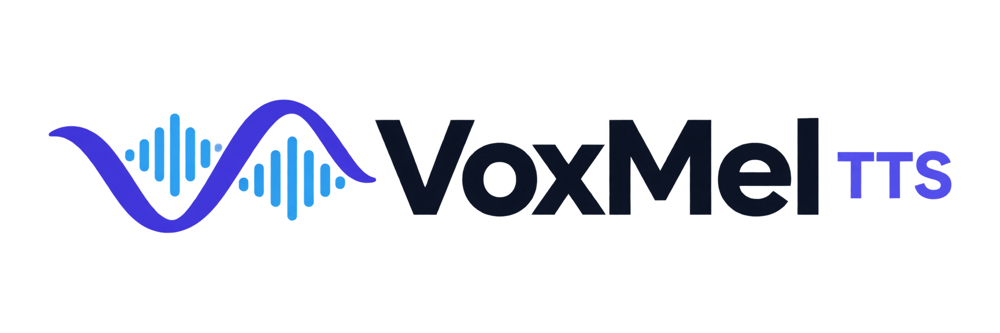
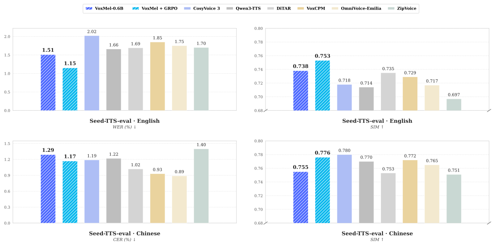
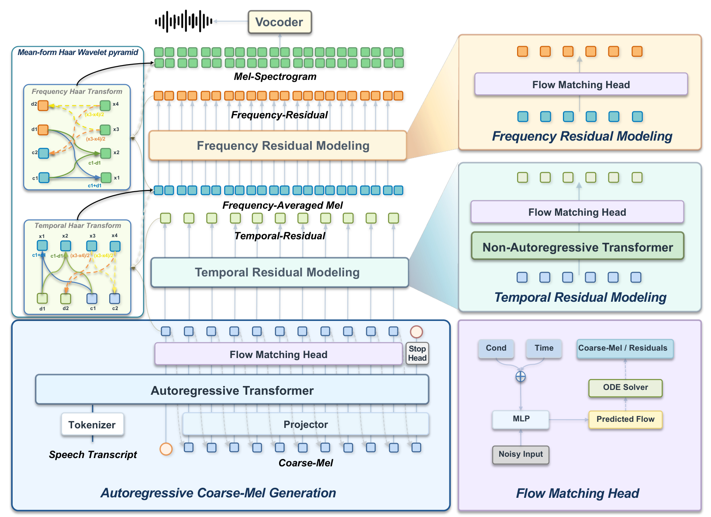

<h2 align="center">VoxMel: 제로샷 음성 합성을 위한 웨이블릿 분해 기반 자기회귀 멜 스펙트로그램 모델링</h2>

<p align="center">
  <b>English</b> | <a href="./README_zh.md">中文</a> | <a href="./README_jap.md">日語</a> | <a href="./README_kor.md">한국어</a>
</p>

<p align="center">
  <picture>
    <source media="(prefers-color-scheme: dark)" srcset="assets/voxmel-logo-dark.png">
    <source media="(prefers-color-scheme: light)" srcset="assets/voxmel-logo.png">
    
  </picture>
</p>

<p align="center">
  📄 <a href="./assets/papers/VoxMel_Technical_Report.pdf">기술 보고서</a> &nbsp;|&nbsp;
  🌐 <a href="https://voxdance.github.io/voxmel-demo">프로젝트 페이지</a> &nbsp;|&nbsp;
  💻 <a href="https://github.com/VoxDance-Lab/VoxMel">GitHub</a> &nbsp;|&nbsp;
  🤗 <a href="https://huggingface.co/VoxDance-Lab/">Hugging Face</a>
</p>


## 🔥 📰 소식

- **2026.11.16** — 기술 보고서 공개!
- **2026.11.12** — 코드 및 모델 가중치(VoxMel-0.6B / VoxMel-0.3B) 공개!

---

**VoxMel**은 고정된 정확히 가역적인 2축 Haar 변환으로 멜 스펙트로그램을 직접 모델링하는, 음향 tokenizer가 필요 없는 연속 자기회귀 텍스트 음성 합성(TTS) 프레임워크입니다. 플로 매칭 헤드를 갖춘 언어 모델 백본이 **Coarse-Mel**을 자기회귀 방식으로 생성하고, 두 비자기회귀 잔차 계층이 시간 및 주파수 세부 정보를 복원합니다. 이 세부 정보는 자기회귀 이력에 다시 입력되지 않습니다. 별도의 Vocos 보코더가 복원된 멜 스펙트로그램을 음성으로 변환합니다.

VoxMel은 **Emilia 데이터 100K시간**으로 학습되었으며 영어와 중국어 제로샷 음성 복제로 평가됩니다. **0.6B** 지도 학습 모델은 Seed-TTS-eval test-en에서 **1.51% WER / 0.738 SIM**을 달성하며, 헤드를 고정한 GRPO를 적용하면 **1.15% WER / 0.753 SIM**으로 개선됩니다. 비교 및 평가 절차는 [평가](#-evaluation)를 참조하세요.

### ✨ 주요 특징

- **직접 멜 모델링** — 학습된 음향 tokenizer나 압축 음향 잠재 공간을 사용하지 않습니다. 텍스트 프런트엔드는 Qwen2.5 tokenizer를 사용합니다.
- **정확히 가역적인 분해** — 주파수 및 시간 Haar 분해는 모든 멜 계수를 보존합니다. 정확한 가역성은 변환 자체의 특성이며, 생성 음성이나 보코더 복원이 무손실임을 보장하지 않습니다.
- **거친 성분만 자기회귀 생성** — Coarse-Mel을 먼저 생성한 다음 의존 순서에 따라 시간 잔차와 주파수 잔차를 생성합니다. 잔차 세부 정보는 자기회귀 이력에 포함되지 않습니다.
- **영어 및 중국어 제로샷 복제** — 참조 오디오와 전사문으로 음성을 합성하며 논문의 설정에서는 24 kHz로 출력합니다.

- **후학습** — 헤드를 고정한 GRPO가 Seed-TTS-eval의 네 지표를 모두 개선합니다.

---

## 목차

- [성능](#performance)
- [모델 구조](#model-architecture)
- [빠른 시작](#-quick-start)
  - [설치](#installation)
  - [모델 파일 준비](#prepare-model-files)
  - [Python API](#python-api)
  - [CLI 사용법](#cli-usage)
  - [웹 데모](#web-demo)
- [모델](#-models)
- [방법](#-method)
- [평가](#-evaluation)
  - [Seed-TTS-eval 결과](#seed-tts-eval-results)
  - [Seed-TTS 일괄 평가](#seed-tts-batch-evaluation)
- [라이선스](#-license)
- [🤝 커뮤니티 감사의 글](#-community-acknowledgments)
- [기여 기관](#-Contributors)
- [인용](#-Citation)

---

<a id="performance"></a>

## 성능



대표 시스템과의 Seed-TTS-eval 비교입니다. 파란색: 지도 학습 VoxMel-0.6B, 청록색: VoxMel-0.6B + GRPO. 전체 표는 [평가](#-evaluation)를 참조하세요.

<a id="model-architecture"></a>

## 모델 구조




---

<a id="-quick-start"></a>

## 🚀 빠른 시작

<a id="installation"></a>

### 설치

Python 3.10–3.12를 사용하세요. 하드웨어에 맞고 서로 호환되는 PyTorch와 torchaudio를 설치한 다음(원래 환경: torch/torchaudio 2.4.1 및 CUDA 12.1), 저장소 루트에서 설치하세요:

```bash
pip install -e .
```

패키지 설치 프로그램은 `requirements.txt`를 공통으로 사용하며 Vocos가 포함되어 있습니다. CPU 또는 Apple Silicon에서는 적절한 PyTorch 빌드를 사용하세요. `device="auto"`는 CUDA, MPS, CPU 순으로 선택하며, 사용할 수 없는 장치를 명시하면 오류가 발생합니다. MPS 연산자 지원 및 성능은 사용 중인 체크포인트로 검증해야 합니다.

<a id="prepare-model-files"></a>

### 모델 파일 준비

현재 체크아웃에는 모델 코드와 Qwen tokenizer가 포함되지만 **학습된 VoxMel 가중치, 실험 설정 또는 Vocos 가중치는 포함되지 않습니다**. 호환되는 실험 파일을 준비하세요:

```text
/path/to/experiment/
├── config.yaml
└── model_L_final.pt
/path/to/vocos-mel-24khz/
├── config.yaml
└── pytorch_model.bin
```

<a id="python-api"></a>

### Python API

```python
from voxcore import VoxMel
import soundfile as sf

model = VoxMel.from_pretrained(
    "/path/to/experiment",
    tokenizer_path="examples/voxmel/qwen_tokenizer",
    vocos_path="/path/to/vocos-mel-24khz",
    device="auto",
)

# 오디오 이어 생성 방식의 복제에는 정확한 참조 전사문이 필요합니다.
wav = model.generate(
    "这是声音克隆的演示。",
    prompt_wav_path="reference.wav",
    prompt_text="参考音频中实际说出的内容。",
    cfg_text_strength=3.5,
    cfg_spk_strength=3.0,
    seed=42,
)
sf.write("clone.wav", wav, model.sample_rate)
```

API는 추론 모드로 실행되며 모노 float32 NumPy 파형을 반환합니다. `min_seconds`와 `max_seconds`는 거친 프레임 생성 범위를 제어하며 실제 길이는 모델의 정지 예측에도 영향을 받습니다. `cfg_text_strength`와 `cfg_spk_strength`는 텍스트 및 화자 가이던스를 독립적으로 제어하며, `up_num_steps`는 잔차 솔버의 스텝 수를 설정합니다. 화자 가이던스는 참조 오디오가 제공될 때만 적용됩니다.

<a id="cli-usage"></a>

### CLI 사용법

설치 후 저장소 루트에서 실행하세요:

```bash
voxmel --model /path/to/experiment \
  --tokenizer-path examples/voxmel/qwen_tokenizer \
  --vocos-path /path/to/vocos-mel-24khz \
  --prompt-audio reference.wav \
  --prompt-text "参考音频转录文本" \
  --text "这是声音克隆的演示。" \
  --cfg-text-strength 3.5 --cfg-spk-strength 3.0 \
  --seed 42 --output out.wav


voxmel --help
```

<a id="web-demo"></a>

### 웹 데모

선택 사항인 Gradio 의존성을 설치하고 저장소 루트에서 실행하세요:

```bash
pip install -e ".[web]"

python app.py \
  --model /path/to/experiment \
  --tokenizer-path examples/voxmel/qwen_tokenizer \
  --vocos-path /path/to/vocos-mel-24khz \
  --device auto \
  --port 8808
```

**http://127.0.0.1:8808**을 여세요. 데모는 음성 복제만 지원합니다. 목표 텍스트를 입력하고 참조 오디오와 정확한 전사문을 모두 제공하거나 `assets/voice_cloning`에 포함된 로컬 예제를 클릭하세요. 결과는 재생하거나 WAV로 다운로드할 수 있습니다. 인터페이스는 영어 및 중국어 레이블을 제공하며 생성 설정에서 솔버 스텝 수, 길이 범위, 가이던스를 조절할 수 있습니다. 난수 시드는 **42**로 고정되며 각 결과에 표시됩니다.

데모는 시작 시 로컬 모델을 한 번 로드하고 생성 요청을 대기열에서 하나씩 처리합니다. 모델 및 Vocos 파일은 [모델 파일 준비](#prepare-model-files)에 따라 준비해야 합니다. 텍스트 CFG와 화자 CFG는 독립적이며 기본값은 각각 **3.5**와 **3.0**입니다. 거친 성분 및 잔차 솔버의 기본 스텝 수는 모두 32입니다.

`--device cpu`, `--device mps` 또는 `--device cuda:0`으로 장치를 명시적으로 선택하세요. 다른 체크포인트 파일명은 `--checkpoint`로 지정하고, 다른 컴퓨터의 접속을 허용하려면 `--host 0.0.0.0`을 사용하세요. 전체 실행 옵션은 `python app.py --help`로 확인하세요.


---

<a id="-models"></a>

## 📦 모델

**현재 오픈소스로 공개된 모델은 VoxMel-0.6B와 VoxMel-0.3B입니다.** 고정 Haar 분해, 플로 매칭 헤드, 고정된 24 kHz Vocos 보코더를 사용합니다.

체크포인트는 Hugging Face의 [VoxDance-Lab/VoxMel-0.6B](https://huggingface.co/VoxDance-Lab/VoxMel-0.6B) 및 [VoxDance-Lab/VoxMel-0.3B](https://huggingface.co/VoxDance-Lab/VoxMel-0.3B)에서 받을 수 있습니다. 모델 파일을 다운로드한 뒤 [모델 파일 준비](#prepare-model-files)에 따라 로컬 추론을 설정하세요.

**강화 학습 후학습(헤드를 고정한 GRPO)은 VoxMel-0.6B에만 적용되었으며 VoxMel-0.3B에는 적용되지 않았습니다.**


---

<a id="-method"></a>

## 💡 방법

### 동기

기존 연속 자기회귀 TTS 시스템은 고차원 음성 생성을 다루기 위해 학습된 음향 표현에 의존하는 경우가 많습니다. 신경망 압축은 자기회귀 모델링을 단순화하지만 추가적인 표현 학습 단계를 도입하며 복원 병목을 만들 수 있습니다.

VoxMel은 근본적인 질문을 던집니다. **고충실도 연속 자기회귀 음성 생성에 학습된 음향 압축이 반드시 필요할까요?**

우리는 멜 스펙트로그램을 음향 모델링 대상으로 다시 검토합니다. 핵심 관찰은 주요 과제가 표현 자체보다는 자기회귀 예측을 위해 음향 정보를 어떻게 구성하는지에 있을 수 있다는 것입니다.

### 생성 과정

1. **멜 특징 분해:** 주파수 축을 따라 주파수 평균 멜(Frequency-Averaged Mel)과 주파수 잔차로 분해한 다음, Frequency-Averaged Mel을 시간 축을 따라 Coarse-Mel과 시간 잔차로 분해합니다.
2. **Coarse-Mel 생성:** 디코더 전용 transformer가 텍스트, 참조 음성, 이전의 거친 단위를 바탕으로 플로 매칭 헤드에 조건을 제공합니다.
3. **시간 세부 정보 예측:** 비자기회귀 계층이 Coarse-Mel로부터 시간 잔차를 예측합니다. 시간 축 역 Haar 변환으로 Frequency-Averaged Mel을 복원합니다.
4. **주파수 세부 정보 예측:** 두 번째 계층이 복원된 Frequency-Averaged Mel로부터 주파수 잔차를 예측합니다. 주파수 축 역 Haar 변환으로 전체 멜 스펙트로그램을 복원합니다.
5. **파형 합성:** 고정된 Vocos 보코더가 멜 특징을 24 kHz 음성으로 변환합니다.

계층은 순차적으로 실행되며 각 계층 내 위치는 비자기회귀 방식으로 예측됩니다. 두 잔차 모두 Coarse-Mel 이력에 포함되지 않습니다. 논문은 100채널 로그 멜, 1024포인트 FFT/윈도, 256샘플 홉, 24 kHz 샘플링을 사용합니다. 전체 멜의 프레임률은 93.75 Hz, Coarse-Mel은 46.875 Hz입니다.


---

<a id="-evaluation"></a>

## 📊 평가

<a id="seed-tts-eval-results"></a>

### Seed-TTS-eval 결과

제로샷 음성 복제 결과입니다. WER/CER은 백분율(낮을수록 좋음), SIM은 화자 임베딩의 코사인 유사도(높을수록 좋음)입니다. 굵은 지표 값은 표의 각 열에서 가장 좋은 결과를 나타냅니다.
| 모델 | 파라미터 수 | 학습 시간 | EN WER ↓ (%) | EN SIM ↑ | ZH CER ↓ (%) | ZH SIM ↑ |
| --- | ---: | ---: | ---: | ---: | ---: | ---: |
| CosyVoice | 0.3B | 170K | 3.39 | 0.629 | 3.63 | 0.723 |
| CosyVoice 2 | 0.5B | 167K | 2.57 | 0.652 | 1.45 | 0.748 |
| CosyVoice 3 | 1.1B | 1.0M | 2.02 | 0.718 | 1.19 | **0.780** |
| Spark-TTS | 0.5B | 102K | 1.98 | 0.584 | 1.20 | 0.672 |
| MaskGCT | 1.0B | 100K | 2.88 | 0.713 | 2.40 | 0.773 |
| FireRedTTS 2 | 1.5B | 1.4M | 1.95 | 0.665 | 1.14 | 0.736 |
| Qwen3-TTS | 1.7B | 5.0M | 1.66 | 0.714 | 1.22 | 0.770 |
| IndexTTS 2 | 1.7B | 55K | 2.23 | 0.706 | 1.03 | 0.765 |
| VibeVoice | 1.5B | — | 3.04 | 0.689 | 1.16 | 0.744 |
| MOSS-TTS | 8.0B | — | 1.84 | 0.709 | 1.37 | 0.770 |
| MOSS-TTS-Nano | 0.1B | — | 4.62 | 0.499 | 3.13 | 0.643 |
| DiTAR | 0.6B | 280K | 1.69 | 0.735 | 1.02 | 0.753 |
| VoxCPM | 0.7B | 1.8M | 1.85 | 0.729 | 0.93 | 0.772 |
| OmniVoice-Emilia | 0.8B | 100K | 1.75 | 0.717 | **0.89** | 0.765 |
| E2-TTS (32 NFE) | 0.3B | 100K | 2.32 | 0.706 | 1.91 | 0.713 |
| F5-TTS (32 NFE) | 0.3B | 100K | 1.85 | 0.664 | 1.53 | 0.750 |
| ZipVoice (16 NFE) | 0.1B | 100K | 1.70 | 0.697 | 1.40 | 0.751 |
| **VoxMel-0.6B** | 0.6B | 100K | 1.51 | 0.738 | 1.29 | 0.755 |
| **VoxMel-0.6B + GRPO** | 0.6B | 100K | **1.15** | **0.753** | 1.17 | 0.776 |

나열된 기존 시스템과 비교할 때 지도 학습 VoxMel 모델은 가장 낮은 영어 WER과 가장 높은 영어 SIM을 보이며, GRPO가 두 지표를 추가로 개선합니다.

<a id="seed-tts-batch-evaluation"></a>

### Seed-TTS 일괄 평가

```bash
cd examples/voxmel
EXP_DIR=/path/to/experiment VOCOS_PATH=/path/to/vocos-mel-24khz \
TESTSET=/path/to/seedtts_testset bash infer_seedtts_voxmel.sh
```

테스트 세트에는 `zh/meta.lst`와 `en/meta.lst`가 포함되며 각 행의 형식은
`id|prompt transcript|prompt audio path|target text`입니다. 오디오 경로는 각 언어 디렉터리 기준 상대 경로입니다. 스크립트는 환경 변수를 통한 `GPU`, `NPROC`, `MAX_ITEMS`, `COARSE_STEPS`, `UP_STEPS`, CFG 재설정을 지원하며 기존 출력은 건너뜁니다. CUDA를 사용하지 않는 추론에서는 `DEVICE=cpu` 또는 `DEVICE=mps`와 함께 `NPROC=1`을 사용하세요.


---

<a id="-community-acknowledgments"></a>

## 🤝 커뮤니티 감사의 글

> [!TIP]
> **Apple Silicon Mac에서 VoxMel 네이티브 실행**
>
> Apple의 MLX 프레임워크로 VoxMel 커뮤니티 포트를 개발해 주신 [@vanch007](https://github.com/vanch007)님께 감사드립니다. BF16, 8-bit 및 4-bit 가중치를 사용한 로컬 추론을 지원합니다.
>
> **[mlx-voxmel 살펴보고 시작하기 →](https://github.com/vanch007/mlx-voxmel)**


---

<a id="-license"></a>

## 📄 라이선스

VoxMel 코드와 모델 가중치는 [Apache License 2.0](https://www.apache.org/licenses/LICENSE-2.0)에 따라 배포됩니다. 타사 구성 요소에는 각 구성 요소의 라이선스가 적용됩니다.

---

<p align="center">
  개발
  <br><br>
  
  <br>
  <b>VoxDance Lab</b>
</p>


---

<a id="-Contributors"></a>

## 기여 기관

<p align="center">
  다음 기관의 기여에 깊이 감사드립니다.
</p>

<table align="center">
  <tr>
    <td align="center" valign="middle" width="210">
      
      <br><sub>상하이 창즈학원</sub>
    </td>
    <td align="center" valign="middle" width="210">
      
      <br><sub>샤먼대학교</sub>
    </td>
    <td align="center" valign="middle" width="210">
      
      <br><sub>상하이교통대학교</sub>
    </td>
  </tr>
  <tr>
    <td align="center" valign="middle">
      
      <br><sub>푸단대학교</sub>
    </td>
    <td align="center" valign="middle">
      
      <br><sub>저장대학교</sub>
    </td>
    <td align="center" valign="middle">
      
      <br><sub>교토대학교</sub>
    </td>
  </tr>
</table>


---

<a id="-Citation"></a>

## 📖 인용

VoxMel이 연구나 업무에 도움이 되었다면 기술 보고서를 인용해 주세요:

```bibtex
@misc{guan2026voxmel,
  title  = {VoxMel TTS Technical Report},
  author = {Guan, Wenhao and Ye, Jiaxin and Li, Haitao and Duan, Yifan and
            Liu, Junxi and Zhou, Wangjin and Li, Lin and Hong, Qingyang and Chen, Xie},
  year   = {2026},
  eprint        = {2611.20254},
  archivePrefix = {arXiv},
  url           = {https://arxiv.org/abs/2611.20254}
}
```


