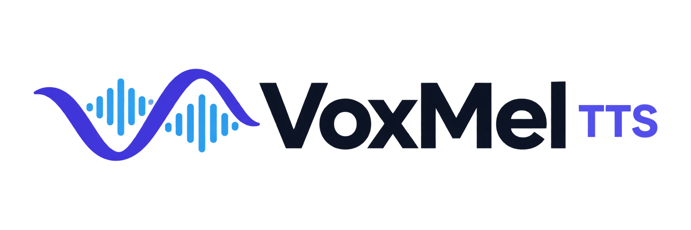
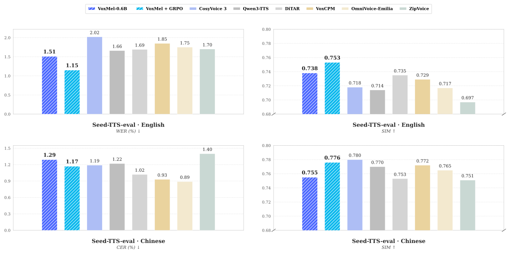
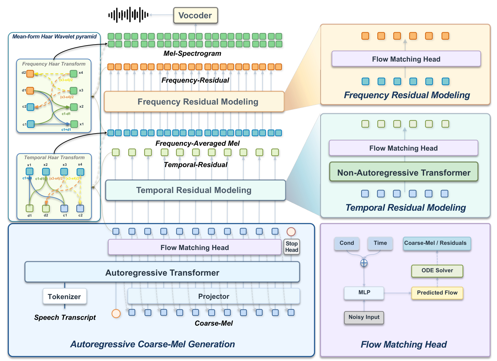

<h2 align="center">VoxMel: Wavelet-Factorized Autoregressive Mel-Spectrogram Modeling for Zero-Shot Speech Synthesis</h2>

<p align="center">
  <b>English</b> | <a href="./README_zh.md">中文</a> | <a href="./README_jap.md">日語</a> | <a href="./README_kor.md">한국어</a>
</p>

<p align="center">
  <picture>
    <source media="(prefers-color-scheme: dark)" srcset="assets/voxmel-logo-dark.png">
    <source media="(prefers-color-scheme: light)" srcset="assets/voxmel-logo.png">
    
  </picture>
</p>

<p align="center">
  📄 <a href="./assets/papers/VoxMel_Technical_Report.pdf">技术报告</a> &nbsp;|&nbsp;
  🌐 <a href="https://voxdance.github.io/voxmel-demo">项目主页</a> &nbsp;|&nbsp;
  💻 <a href="https://github.com/VoxDance-Lab/VoxMel">GitHub</a> &nbsp;|&nbsp;
  🤗 <a href="https://huggingface.co/VoxDance-Lab/">Hugging Face</a>
</p>


## 🔥 📰 最新动态

- **2026.11.16** — 技术报告已发布！
- **2026.11.12** — 代码和模型权重（VoxMel-0.6B / VoxMel-0.3B）已发布！

---

**VoxMel** 是一个无需声学 tokenizer 的连续自回归文本转语音（TTS）框架，通过固定且精确可逆的双轴 Haar 变换直接建模梅尔频谱。带有流匹配头的语言模型骨干以自回归方式生成 **Coarse-Mel**；两个非自回归残差层级恢复时间和频率细节，且不将这些细节反馈到自回归历史中。独立的 Vocos 声码器将重建的梅尔频谱转换为语音。

VoxMel 使用 **100K 小时的 Emilia 数据**训练，并在英语和中文零样本声音克隆任务上进行评估。**0.6B** 监督训练模型在 Seed-TTS-eval test-en 上达到 **1.51% WER / 0.738 SIM**；冻结头部的 GRPO 将其提升至 **1.15% WER / 0.753 SIM**。对比结果及评估协议见[评估](#-evaluation)。

### ✨ 亮点

- **直接建模梅尔频谱** — 无需学习得到的声学 tokenizer 或压缩声学潜在空间；文本前端使用 Qwen2.5 tokenizer。
- **精确可逆分解** — 频率和时间 Haar 分解保留所有梅尔系数。精确可逆性针对变换本身，并不保证生成音频或声码器重建无损。
- **仅对粗粒度部分进行自回归** — 首先生成 Coarse-Mel，再按依赖顺序生成时间残差和频率残差。残差细节不进入自回归历史。
- **英语和中文零样本克隆** — 根据参考音频及其转录文本合成语音，论文配置下输出采样率为 24 kHz。

- **后训练** — 冻结头部的 GRPO 改善了全部四项 Seed-TTS-eval 指标。

---

## 目录

- [性能](#performance)
- [模型架构](#model-architecture)
- [快速开始](#-quick-start)
  - [安装](#installation)
  - [准备模型文件](#prepare-model-files)
  - [Python API](#python-api)
  - [命令行用法](#cli-usage)
  - [网页演示](#web-demo)
- [模型](#-models)
- [方法](#-method)
- [评估](#-evaluation)
  - [Seed-TTS-eval 结果](#seed-tts-eval-results)
  - [Seed-TTS 批量评估](#seed-tts-batch-evaluation)
- [许可证](#-license)
- [🤝 社区致谢](#-community-acknowledgments)
- [贡献单位](#-Contributors)
- [引用](#-Citation)

---

<a id="performance"></a>

## 性能



与代表性系统在 Seed-TTS-eval 上的对比。蓝色：监督训练的 VoxMel-0.6B；青色：VoxMel-0.6B + GRPO。完整表格见[评估](#-evaluation)。

<a id="model-architecture"></a>

## 模型架构




---

<a id="-quick-start"></a>

## 🚀 快速开始

<a id="installation"></a>

### 安装

使用 Python 3.10–3.12。安装适合硬件且版本匹配的 PyTorch 和 torchaudio（原始环境使用 torch/torchaudio 2.4.1 和 CUDA 12.1），然后在仓库根目录执行安装：

```bash
pip install -e .
```

软件包安装程序共用 `requirements.txt`，其中已包含 Vocos。CPU 或 Apple Silicon 请使用适合的 PyTorch 版本。`device="auto"` 按 CUDA、MPS、CPU 的顺序选择设备；显式指定不可用设备会报错。MPS 算子支持和性能仍需使用你的检查点验证。

<a id="prepare-model-files"></a>

### 准备模型文件

当前检出的仓库包含模型代码和 Qwen tokenizer，但**不包含训练好的 VoxMel 权重、实验配置或 Vocos 权重**。请准备兼容的实验文件：

```text
/path/to/experiment/
├── config.yaml
└── model_L_final.pt
/path/to/vocos-mel-24khz/
├── config.yaml
└── pytorch_model.bin
```

<a id="python-api"></a>

### Python API

```python
from voxcore import VoxMel
import soundfile as sf

model = VoxMel.from_pretrained(
    "/path/to/experiment",
    tokenizer_path="examples/voxmel/qwen_tokenizer",
    vocos_path="/path/to/vocos-mel-24khz",
    device="auto",
)

# 音频续接克隆需要准确的参考音频转录文本。
wav = model.generate(
    "这是声音克隆的演示。",
    prompt_wav_path="reference.wav",
    prompt_text="参考音频中实际说出的内容。",
    cfg_text_strength=3.5,
    cfg_spk_strength=3.0,
    seed=42,
)
sf.write("clone.wav", wav, model.sample_rate)
```

API 在推理模式下运行，返回单声道 float32 NumPy 波形。`min_seconds` 和 `max_seconds` 控制粗粒度帧的生成范围；模型的停止预测会影响实际时长。`cfg_text_strength` 和 `cfg_spk_strength` 分别控制文本引导和说话人引导，`up_num_steps` 设置残差求解器步数。只有提供参考音频时才应用说话人引导。

<a id="cli-usage"></a>

### 命令行用法

安装后，在仓库根目录运行：

```bash
voxmel --model /path/to/experiment \
  --tokenizer-path examples/voxmel/qwen_tokenizer \
  --vocos-path /path/to/vocos-mel-24khz \
  --prompt-audio reference.wav \
  --prompt-text "参考音频转录文本" \
  --text "这是声音克隆的演示。" \
  --cfg-text-strength 3.5 --cfg-spk-strength 3.0 \
  --seed 42 --output out.wav


voxmel --help
```

<a id="web-demo"></a>

### 网页演示

安装可选的 Gradio 依赖，并在仓库根目录启动：

```bash
pip install -e ".[web]"

python app.py \
  --model /path/to/experiment \
  --tokenizer-path examples/voxmel/qwen_tokenizer \
  --vocos-path /path/to/vocos-mel-24khz \
  --device auto \
  --port 8808
```

打开 **http://127.0.0.1:8808**。演示仅支持声音克隆：输入目标文本，同时提供参考音频及其准确转录文本，或点击 `assets/voice_cloning` 中随附的本地示例。结果可播放并下载为 WAV。界面提供中英文标签；生成设置包括求解器步数、时长范围和引导强度。随机种子固定为 **42**，并随每个结果显示。

演示在启动时加载一次本地模型，并按队列逐一处理生成请求。模型和 Vocos 文件须按[准备模型文件](#prepare-model-files)所述准备。文本 CFG 和说话人 CFG 相互独立，默认分别为 **3.5** 和 **3.0**。粗粒度和残差求解器的默认步数均为 32。

使用 `--device cpu`、`--device mps` 或 `--device cuda:0` 显式选择设备。使用 `--checkpoint` 指定其他检查点文件名，使用 `--host 0.0.0.0` 允许其他机器访问。运行 `python app.py --help` 查看全部启动选项。


---

<a id="-models"></a>

## 📦 模型

**目前开源的模型为 VoxMel-0.6B 和 VoxMel-0.3B。** 模型采用固定 Haar 分解、流匹配头和冻结的 24 kHz Vocos 声码器。

检查点可从 Hugging Face 获取：[VoxDance-Lab/VoxMel-0.6B](https://huggingface.co/VoxDance-Lab/VoxMel-0.6B) 和 [VoxDance-Lab/VoxMel-0.3B](https://huggingface.co/VoxDance-Lab/VoxMel-0.3B)。下载模型文件后，按照[准备模型文件](#prepare-model-files)配置本地推理。

**仅 VoxMel-0.6B 进行了强化学习后训练（冻结头部的 GRPO）；VoxMel-0.3B 未进行该后训练。**


---

<a id="-method"></a>

## 💡 方法

### 动机

现有连续自回归 TTS 系统通常依赖学习得到的声学表示，使高维语音生成易于处理。神经压缩虽简化了自回归建模，但也引入额外的表示学习阶段，并可能造成重建瓶颈。

VoxMel 提出一个根本问题：**高保真连续自回归语音生成是否必须依赖学习得到的声学压缩？**

我们重新审视将梅尔频谱作为声学建模目标的方案。关键观察是：主要挑战未必在于表示本身，而在于如何组织声学信息以进行自回归预测。

### 生成流程

1. **分解梅尔特征：** 沿频率轴分解为频率平均梅尔特征（Frequency-Averaged Mel）和频率残差，再沿时间轴将 Frequency-Averaged Mel 分解为 Coarse-Mel 和时间残差。
2. **生成 Coarse-Mel：** 仅解码器 transformer 根据文本、参考语音和先前的粗粒度单元，为流匹配头提供条件。
3. **预测时间细节：** 非自回归层级根据 Coarse-Mel 预测时间残差。逆时间 Haar 变换重建 Frequency-Averaged Mel。
4. **预测频率细节：** 第二个层级根据重建的 Frequency-Averaged Mel 预测频率残差。逆频率 Haar 变换恢复完整梅尔频谱。
5. **合成波形：** 冻结的 Vocos 声码器将梅尔特征转换为 24 kHz 语音。

各层级依次运行，而每个层级内部各位置以非自回归方式预测。两种残差均不进入 Coarse-Mel 历史。论文采用 100 通道对数梅尔频谱、1024 点 FFT/窗长、256 采样点帧移和 24 kHz 采样率：完整梅尔频谱帧率为 93.75 Hz，Coarse-Mel 为 46.875 Hz。


---

<a id="-evaluation"></a>

## 📊 评估

<a id="seed-tts-eval-results"></a>

### Seed-TTS-eval 结果

零样本声音克隆结果。WER/CER 为百分比（越低越好）；SIM 为说话人嵌入的余弦相似度（越高越好）。粗体指标值表示本表各列的最佳结果。
| 模型 | 参数量 | 训练时长 | EN WER ↓ (%) | EN SIM ↑ | ZH CER ↓ (%) | ZH SIM ↑ |
| --- | ---: | ---: | ---: | ---: | ---: | ---: |
| CosyVoice | 0.3B | 170K | 3.39 | 0.629 | 3.63 | 0.723 |
| CosyVoice 2 | 0.5B | 167K | 2.57 | 0.652 | 1.45 | 0.748 |
| CosyVoice 3 | 1.1B | 1.0M | 2.02 | 0.718 | 1.19 | **0.780** |
| Spark-TTS | 0.5B | 102K | 1.98 | 0.584 | 1.20 | 0.672 |
| MaskGCT | 1.0B | 100K | 2.88 | 0.713 | 2.40 | 0.773 |
| FireRedTTS 2 | 1.5B | 1.4M | 1.95 | 0.665 | 1.14 | 0.736 |
| Qwen3-TTS | 1.7B | 5.0M | 1.66 | 0.714 | 1.22 | 0.770 |
| IndexTTS 2 | 1.7B | 55K | 2.23 | 0.706 | 1.03 | 0.765 |
| VibeVoice | 1.5B | — | 3.04 | 0.689 | 1.16 | 0.744 |
| MOSS-TTS | 8.0B | — | 1.84 | 0.709 | 1.37 | 0.770 |
| MOSS-TTS-Nano | 0.1B | — | 4.62 | 0.499 | 3.13 | 0.643 |
| DiTAR | 0.6B | 280K | 1.69 | 0.735 | 1.02 | 0.753 |
| VoxCPM | 0.7B | 1.8M | 1.85 | 0.729 | 0.93 | 0.772 |
| OmniVoice-Emilia | 0.8B | 100K | 1.75 | 0.717 | **0.89** | 0.765 |
| E2-TTS (32 NFE) | 0.3B | 100K | 2.32 | 0.706 | 1.91 | 0.713 |
| F5-TTS (32 NFE) | 0.3B | 100K | 1.85 | 0.664 | 1.53 | 0.750 |
| ZipVoice (16 NFE) | 0.1B | 100K | 1.70 | 0.697 | 1.40 | 0.751 |
| **VoxMel-0.6B** | 0.6B | 100K | 1.51 | 0.738 | 1.29 | 0.755 |
| **VoxMel-0.6B + GRPO** | 0.6B | 100K | **1.15** | **0.753** | 1.17 | 0.776 |

在所列先前系统中，监督训练的 VoxMel 模型具有最低的英语 WER 和最高的英语 SIM；GRPO 进一步改善了这两项指标。

<a id="seed-tts-batch-evaluation"></a>

### Seed-TTS 批量评估

```bash
cd examples/voxmel
EXP_DIR=/path/to/experiment VOCOS_PATH=/path/to/vocos-mel-24khz \
TESTSET=/path/to/seedtts_testset bash infer_seedtts_voxmel.sh
```

测试集包含 `zh/meta.lst` 和 `en/meta.lst`，每行格式为
`id|prompt transcript|prompt audio path|target text`。音频路径相对于各语言目录。脚本支持通过环境变量覆盖 `GPU`、`NPROC`、`MAX_ITEMS`、`COARSE_STEPS`、`UP_STEPS` 和 CFG，并跳过已有输出。非 CUDA 推理请使用 `DEVICE=cpu` 或 `DEVICE=mps`，同时设置 `NPROC=1`。


---

<a id="-community-acknowledgments"></a>

## 🤝 社区致谢

> [!TIP]
> **在 Apple Silicon Mac 上原生运行 VoxMel**
>
> 感谢 [@vanch007](https://github.com/vanch007) 使用 Apple 的 MLX 框架构建 VoxMel 社区移植版本。该版本支持使用 BF16、8-bit 和 4-bit 权重进行本地推理。
>
> **[探索 mlx-voxmel 并开始使用 →](https://github.com/vanch007/mlx-voxmel)**


---

<a id="-license"></a>

## 📄 许可证

VoxMel 代码和模型权重依据 [Apache License 2.0](https://www.apache.org/licenses/LICENSE-2.0) 发布。第三方组件仍受各自许可证约束。

---

<p align="center">
  开发团队
  <br><br>
  
  <br>
  <b>VoxDance Lab</b>
</p>


---

<a id="-Contributors"></a>

## 贡献单位

<table align="center">
  <tr>
    <td align="center" valign="middle" width="210">
      
      <br><sub>上海创智学院</sub>
    </td>
    <td align="center" valign="middle" width="210">
      
      <br><sub>厦门大学</sub>
    </td>
    <td align="center" valign="middle" width="210">
      
      <br><sub>上海交通大学</sub>
    </td>
  </tr>
  <tr>
    <td align="center" valign="middle">
      
      <br><sub>复旦大学</sub>
    </td>
    <td align="center" valign="middle">
      
      <br><sub>浙江大学</sub>
    </td>
    <td align="center" valign="middle">
      
      <br><sub>京都大学</sub>
    </td>
  </tr>
</table>


---

<a id="-Citation"></a>

## 📖 引用


```bibtex
@misc{guan2026voxmel,
  title  = {VoxMel TTS Technical Report},
  author = {Guan, Wenhao and Ye, Jiaxin and Li, Haitao and Duan, Yifan and
            Liu, Junxi and Zhou, Wangjin and Li, Lin and Hong, Qingyang and Chen, Xie},
  year   = {2026},
  eprint        = {2611.20254},
  archivePrefix = {arXiv},
  url           = {https://arxiv.org/abs/2611.20254}
}
```


