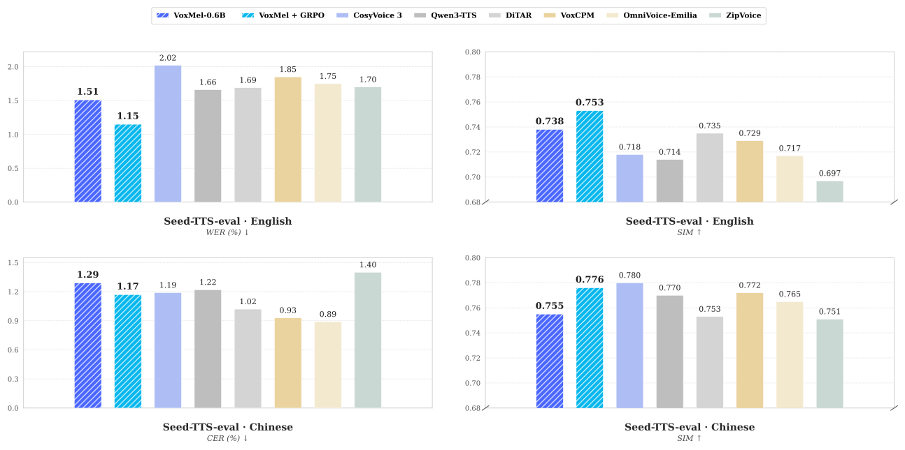
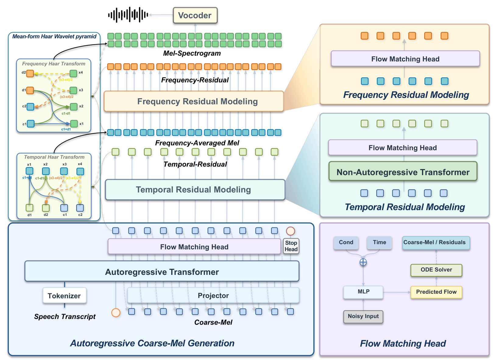

<h2 align="center">VoxMel: Wavelet-Factorized Autoregressive Mel-Spectrogram Modeling for Zero-Shot Speech Synthesis</h2>

<p align="center">
  <a href="./README.md">English</a> | <b>中文</b> | <a href="./README_jap.md">日本語</a> | <a href="./README_kor.md">한국어</a>
</p>

<p align="center">
  <picture>
    <source media="(prefers-color-scheme: dark)" srcset="assets/voxmel-logo-dark.png">
    <source media="(prefers-color-scheme: light)" srcset="assets/voxmel-logo.png">
    
  </picture>
</p>

<p align="center">
  Technical Report (coming soon) |
  <a href="https://voxdance.github.io/voxmel-demo">Project Page</a> |
  <a href="https://github.com/VoxDance-Lab/voxmel">GitHub</a> |
  <a href="https://huggingface.co/VoxDance-Lab/VoxMel-0.6B">Hugging Face</a>
</p>

**VoxMel** 是一种无需声学分词器的连续自回归文本转语音（TTS）框架，通过固定且精确可逆的双轴 Haar 变换直接建模梅尔频谱。语言模型骨干与流匹配预测头以自回归方式生成 **Coarse-Mel**，两个非自回归残差层依次恢复时间和频率细节，且不会将这些残差反馈至自回归历史。独立的 Vocos 声码器将重建的梅尔频谱转换为语音。

VoxMel 使用 **10 万小时 Emilia 数据**训练，并在英语和中文零样本声音克隆任务上评测。**0.6B** 监督模型在 Seed-TTS-eval test-en 上达到 **1.51% WER / 0.738 SIM**；冻结预测头的 GRPO 将结果提升至 **1.15% WER / 0.753 SIM**。对比结果和评测协议见[评测](#evaluation)。

<a id="highlights"></a>

### ✨ 主要亮点

- **直接建模梅尔频谱** — 无需学习声学分词器或压缩声学潜空间；文本前端使用 Qwen2.5 分词器。
- **精确可逆分解** — 沿频率和时间轴的 Haar 分解保留全部梅尔系数。精确可逆指变换本身，并不保证生成音频或声码器重建无损。
- **仅对粗粒度分量自回归** — 先生成 Coarse-Mel，再按依赖顺序生成时间残差和频率残差；残差细节不进入自回归历史。
- **中英文零样本声音克隆** — 使用参考音频及其转录文本合成语音，论文配置输出 24 kHz 音频。

- **后训练** — 冻结预测头的 GRPO 改善了全部四项 Seed-TTS 指标。

---

<a id="contents"></a>

## 目录

- [性能表现](#performance)
- [模型架构](#model-architecture)
- [快速开始](#quick-start)
  - [安装](#installation)
  - [准备模型文件](#prepare-model-files)
  - [Python API](#python-api)
  - [命令行用法](#cli-usage)
  - [Web 演示](#web-demo)
- [模型](#models)
- [方法](#method)
- [评测](#evaluation)
  - [Seed-TTS-eval 结果](#seed-tts-eval-results)
  - [Seed-TTS 批量评测](#seed-tts-batch-evaluation)
- [许可证](#license)

---

<a id="performance"></a>

## 性能表现



与代表性系统的 Seed-TTS-eval 对比。蓝色为监督训练的 VoxMel-0.6B，青色为 VoxMel-0.6B + GRPO。完整结果见[评测](#evaluation)。

<a id="model-architecture"></a>

## 模型架构



---

<a id="quick-start"></a>

## 🚀 快速开始

<a id="installation"></a>

### 安装

使用 Python 3.10–3.12。先为硬件安装相互匹配的 PyTorch 和 torchaudio（原始环境为 torch/torchaudio 2.4.1、CUDA 12.1），再从仓库根目录安装：

```bash
pip install -e .
```

软件包安装程序共用 `requirements.txt`，其中包含 Vocos。CPU 或 Apple Silicon 请使用适用的 PyTorch 构建版本。`device="auto"` 依次选择 CUDA、MPS、CPU；显式指定不可用设备会报错。MPS 算子支持和性能仍需使用实际检查点验证。

<a id="prepare-model-files"></a>

### 准备模型文件

当前代码包含模型实现和 Qwen 分词器，但**不包含训练好的 VoxMel 权重、实验配置或 Vocos 权重**。请准备兼容的实验文件：

```text
/path/to/experiment/
├── config.yaml
└── model_L_final.pt
/path/to/vocos-mel-24khz/
├── config.yaml
└── pytorch_model.bin
```

<a id="python-api"></a>

### Python API

```python
from voxcore import VoxMel
import soundfile as sf

model = VoxMel.from_pretrained(
    "/path/to/experiment",
    tokenizer_path="examples/voxmel/qwen_tokenizer",
    vocos_path="/path/to/vocos-mel-24khz",
    device="auto",
)

# 声音续接克隆需要参考音频的准确转录文本。
wav = model.generate(
    "这是声音克隆的演示。",
    prompt_wav_path="reference.wav",
    prompt_text="参考音频中实际说出的内容。",
    cfg_text_strength=3.5,
    cfg_spk_strength=3.0,
    seed=42,
)
sf.write("clone.wav", wav, model.sample_rate)
```

API 在推理模式下运行，返回单声道 float32 NumPy 波形。`min_seconds` 和 `max_seconds` 控制 Coarse-Mel 的生成帧数范围，实际时长还受模型停止预测影响。`cfg_text_strength` 和 `cfg_spk_strength` 分别控制文本与说话人引导强度，`up_num_steps` 设置残差求解步数。说话人引导仅在提供参考音频时生效。

<a id="cli-usage"></a>

### 命令行用法

安装后，在仓库根目录运行：

```bash
voxmel --model /path/to/experiment \
  --tokenizer-path examples/voxmel/qwen_tokenizer \
  --vocos-path /path/to/vocos-mel-24khz \
  --prompt-audio reference.wav \
  --prompt-text "参考音频转录文本" \
  --text "这是声音克隆的演示。" \
  --cfg-text-strength 3.5 --cfg-spk-strength 3.0 \
  --seed 42 --output out.wav

voxmel --help
```

<a id="web-demo"></a>

### Web 演示

安装可选的 Gradio 依赖，并从仓库根目录启动：

```bash
pip install -e ".[web]"

python app.py \
  --model /path/to/experiment \
  --tokenizer-path examples/voxmel/qwen_tokenizer \
  --vocos-path /path/to/vocos-mel-24khz \
  --device auto \
  --port 8808
```

打开 **http://127.0.0.1:8808**。演示仅支持声音克隆：输入目标文本，并同时提供参考音频及其准确转录文本，或点击 `assets/voice_cloning` 中的内置本地示例。生成结果可在线播放并下载为 WAV。界面提供中英文标签，可设置求解步数、时长范围和引导强度。当前 `app.py` 的随机种子固定为 **0**，并随结果显示。

演示在启动时加载一次本地模型，并逐个排队处理生成请求。请先按[准备模型文件](#prepare-model-files)配置模型和 Vocos 文件。文本 CFG 与说话人 CFG 相互独立，默认分别为 **3.5** 和 **3.0**。Coarse-Mel 和残差的求解步数默认均为 **32**。

可使用 `--device cpu`、`--device mps` 或 `--device cuda:0` 显式选择设备。`--checkpoint` 可指定其他检查点文件名，`--host 0.0.0.0` 可允许其他设备访问。完整启动选项见 `python app.py --help`。

---

<a id="models"></a>

## 📦 模型

**目前开源 VoxMel-0.6B 这一模型。** 该模型使用固定 Haar 分解、流匹配预测头和冻结的 24 kHz Vocos 声码器。

模型检查点已发布至 Hugging Face：[VoxDance-Lab/VoxMel-0.6B](https://huggingface.co/VoxDance-Lab/VoxMel-0.6B)。下载模型文件后，按[准备模型文件](#prepare-model-files)配置本地推理。

| 配置 | VoxMel-0.6B |
| --- | ---: |
| 总参数量（不含声码器） | 690.1M |
| 骨干层数 | 24 |
| 骨干宽度 | 896 |
| 骨干 FFN 宽度 | 4864 |
| 残差层宽度 | 1024 |
| 每个残差层的块数 | 6 |
| 流匹配预测头层数 | 6 |
| 训练数据 | 10 万小时 |

0.6B 模型的骨干由 Qwen2.5-0.5B 初始化。参数分布为：骨干 494.0M、Coarse-Mel 预测头 14.8M、时间残差层 90.6M、频率残差层 90.6M、适配模块 0.1M。冻结的 Vocos 声码器另有 13.6M 参数，不计入上述总量。

---

<a id="method"></a>

## 💡 方法

<a id="motivation"></a>

### 研究动机

现有连续自回归 TTS 系统通常依赖学习得到的声学表示，以降低高维语音生成的难度。神经压缩虽然简化了自回归建模，却也引入额外的表示学习阶段，并可能造成重建瓶颈。

VoxMel 探讨一个基本问题：**高保真连续自回归语音生成是否必须依赖学习得到的声学压缩？**

我们重新审视梅尔频谱作为声学建模目标的潜力。核心观察是：主要挑战未必在于表示本身，而在于如何为自回归预测组织声学信息。

<a id="generation-pipeline"></a>

### 生成流程

1. **分解梅尔特征：** 沿频率轴分解为频率平均梅尔和频率残差，再沿时间轴将频率平均梅尔分解为 Coarse-Mel 和时间残差。
2. **生成 Coarse-Mel：** 仅解码器 Transformer 根据文本、参考语音及历史粗粒度单元，为流匹配预测头提供条件。
3. **预测时间细节：** 非自回归层由 Coarse-Mel 预测时间残差，再通过时间轴逆 Haar 变换重建频率平均梅尔。
4. **预测频率细节：** 第二层根据重建的频率平均梅尔预测频率残差，通过频率轴逆 Haar 变换恢复完整梅尔频谱。
5. **合成波形：** 冻结的 Vocos 声码器将梅尔特征转换为 24 kHz 语音。

各残差层按顺序运行，每层内部的各位置以非自回归方式预测。两种残差均不进入 Coarse-Mel 历史。论文使用 24 kHz、100 通道对数梅尔频谱，FFT/窗长为 1024、帧移为 256 个采样点；完整梅尔帧率为 93.75 Hz，Coarse-Mel 为 46.875 Hz。

---

<a id="evaluation"></a>

## 📊 评测

<a id="seed-tts-eval-results"></a>

### Seed-TTS-eval 结果

零样本声音克隆结果。WER/CER 以百分比表示，越低越好；SIM 为说话人嵌入的余弦相似度，越高越好。加粗数值表示本表该列最佳结果，“—”表示报告未提供该值。

| 模型 | 参数量 | 训练时长（小时） | EN WER ↓ (%) | EN SIM ↑ | ZH CER ↓ (%) | ZH SIM ↑ |
| --- | ---: | ---: | ---: | ---: | ---: | ---: |
| CosyVoice | 0.3B | 170K | 3.39 | 0.629 | 3.63 | 0.723 |
| CosyVoice 2 | 0.5B | 167K | 2.57 | 0.652 | 1.45 | 0.748 |
| CosyVoice 3 | 1.1B | 1.0M | 2.02 | 0.718 | 1.19 | **0.780** |
| Spark-TTS | 0.5B | 102K | 1.98 | 0.584 | 1.20 | 0.672 |
| MaskGCT | 1.0B | 100K | 2.88 | 0.713 | 2.40 | 0.773 |
| FireRedTTS 2 | 1.5B | 1.4M | 1.95 | 0.665 | 1.14 | 0.736 |
| Qwen3-TTS | 1.7B | 5.0M | 1.66 | 0.714 | 1.22 | 0.770 |
| IndexTTS 2 | 1.7B | 55K | 2.23 | 0.706 | 1.03 | 0.765 |
| VibeVoice | 1.5B | — | 3.04 | 0.689 | 1.16 | 0.744 |
| MOSS-TTS | 8.0B | — | 1.84 | 0.709 | 1.37 | 0.770 |
| MOSS-TTS-Nano | 0.1B | — | 4.62 | 0.499 | 3.13 | 0.643 |
| DiTAR | 0.6B | 280K | 1.69 | 0.735 | 1.02 | 0.753 |
| VoxCPM | 0.7B | 1.8M | 1.85 | 0.729 | 0.93 | 0.772 |
| OmniVoice-Emilia | 0.8B | 100K | 1.75 | 0.717 | **0.89** | 0.765 |
| E2-TTS (32 NFE) | 0.3B | 100K | 2.32 | 0.706 | 1.91 | 0.713 |
| F5-TTS (32 NFE) | 0.3B | 100K | 1.85 | 0.664 | 1.53 | 0.750 |
| ZipVoice (16 NFE) | 0.1B | 100K | 1.70 | 0.697 | 1.40 | 0.751 |
| **VoxMel-0.6B** | 0.6B | 100K | 1.51 | 0.738 | 1.29 | 0.755 |
| **VoxMel-0.6B + GRPO** | 0.6B | 100K | **1.15** | **0.753** | 1.17 | 0.776 |

监督训练的 VoxMel 在所列既有系统中取得最低的英语 WER 和最高的英语 SIM；GRPO 进一步改善了这两项指标。

<a id="seed-tts-batch-evaluation"></a>

### Seed-TTS 批量评测

```bash
cd examples/voxmel
EXP_DIR=/path/to/experiment VOCOS_PATH=/path/to/vocos-mel-24khz \
TESTSET=/path/to/seedtts_testset bash infer_seedtts_voxmel.sh
```

测试集包含 `zh/meta.lst` 和 `en/meta.lst`，每行格式为 `id|参考转录文本|参考音频路径|目标文本`。音频路径相对于各语言目录。脚本支持 `GPU`、`NPROC`、`MAX_ITEMS`、`COARSE_STEPS`、`UP_STEPS` 和 CFG 环境变量覆盖，并跳过已有输出。非 CUDA 推理请设置 `DEVICE=cpu` 或 `DEVICE=mps`，并设置 `NPROC=1`。

---

<a id="license"></a>

## 📄 许可证

VoxMel 代码和模型权重采用 [Apache License 2.0](https://www.apache.org/licenses/LICENSE-2.0) 发布。第三方组件仍遵循各自的许可证。

---

<p align="center">
  开发团队
  <br><br>
  
  <br>
  <b>VoxDance Lab</b>
</p>
